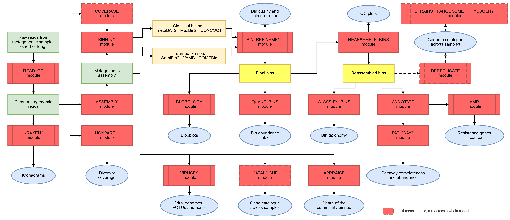
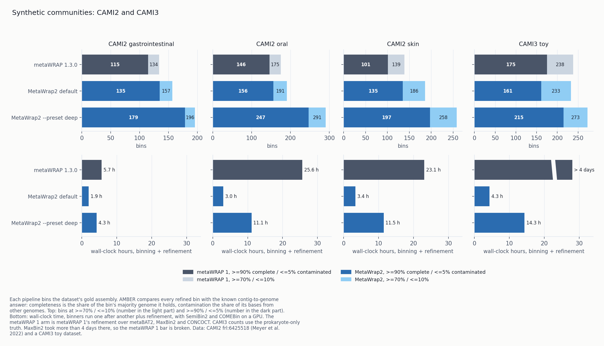
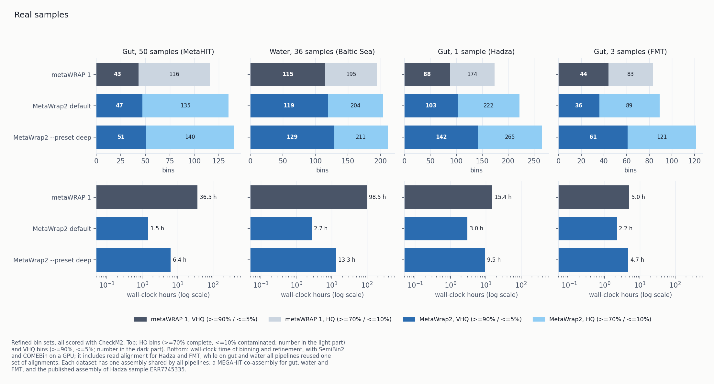

# MetaWrap2: a flexible end-to-end pipeline for genome-resolved functional metagenomics

**From reads to annotated MAGs, with every default chosen by a benchmark.**

[](releases/index.md)

[](LICENSE)

MetaWrap2 is the successor to the widely used and cited [metaWRAP](https://github.com/bxlab/metaWRAP) metagenomics data analysis pipeline. It is completely new software, with a modern Python implementation, automated installation, provenance tracking, and many more user-friendly features. It keeps and modernizes metaWRAP's main modules while also adding learned binners, chimera filtering, cohort-scale workflows and in-depth hierarchical functional annotation. The MetaWrap2 pipeline not only represents the state-of-the-art for recovering and post-processing metagenome-assembled genomes (MAGs) from Illumina short reads, but it also goes further, bringing functional and taxonomic insights and cross-sample analysis for microbiome research projects.



## Why MetaWrap2

- **More genomes.** `--preset deep` recovers more near-complete genomes than metaWRAP 1 on every
  dataset tested: 23% to 95% more on CAMI2 and CAMI3, and 8% to 58% more clean MAGs on four real
  datasets.
- **Faster.** On the metaWRAP 1 paper's own gut samples the default recovers 17% more clean genomes
  in 1.5 hours instead of 36.5 hours. These speed gains become even more prominent with large samples or multi-sample co-assemblies.
- **Cleaner bins.** Every final bin is checked for chimeras with GUNC and tagged with its MIMAG
  quality tier. Bins are scored with CheckM2 by default.
- **Automated multi-env installation.** 55 tools in 16 conda environments that MetaWrap2 builds, checks
  (`metawrap2 doctor`) and runs for you, including tools that cannot share an environment.
- **Reproducible.** Every run records its commands, tool versions, conda packages and database
  fingerprints, and `--resume` continues from the last finished step.
- **Slurm.** `run` and `cohort` with `--executor slurm` submit each step as a Slurm job
  ([Running on Slurm](docs/usage.md#running-on-slurm)).

## Quick start

```bash
git clone https://github.com/ursky/MetaWrap2.git && cd MetaWrap2
pip install .                                    # Python 3.10-3.14
metawrap2 quickstart -t 8                        # build and check the conda environments
metawrap2 install-db checkm2 gunc host --small   # databases for genome recovery

metawrap2 cohort --example > samples.toml        # a commented sample sheet to edit
metawrap2 cohort samples.toml -o study/ -t 32    # QC, assembly, binning, refinement, catalogue
metawrap2 report study/ -o study_report.pdf      # one PDF, plus one row per genome
```

`quickstart` needs `mamba`. Without conda, install
[Miniforge](https://github.com/conda-forge/miniforge), which includes mamba and a current Python.
[Installation](docs/installation.md) covers the details, and the [tutorial](docs/tutorial.md) runs
a smoke test that downloads nothing, then CAMI2 samples with a known answer.

## Example outputs

```
study/
├── READ_QC/<sample>/          trimmed, host-free reads
├── ASSEMBLY/<sample>/         assemblies
├── INITIAL_BINNING/<sample>/  one bin set per binner
├── BIN_REFINEMENT/<sample>/   refined bins with CheckM2, GUNC and MIMAG columns (*.stats.tsv)
├── MAG_CATALOGUE/             one genome per organism across the cohort
├── QUANT_BINS/                each genome's abundance in each sample
└── LOGS/                      every command, its output and its cost
```

From there, `annotate`, `pathways`, `amr`, `viruses`, `strains` and the other modules below work
on the catalogue, the bins or the assemblies.

## Benchmarks

### Synthetic communities (CAMI2 and CAMI3)

Each pipeline bins the dataset's gold assembly, and AMBER compares every bin with the known
contig-to-genome answer, so completeness and contamination are measured instead of estimated.



| Bins ≥90% complete, ≤5% contaminated (wall-clock time) | metaWRAP 1 | MetaWrap2 default | MetaWrap2 `deep` |
|---|---:|---:|---:|
| CAMI2 gastrointestinal | 115 (5.7 h) | 135 (1.9 h) | **179** (4.3 h) |
| CAMI2 oral | 146 (25.6 h) | 156 (3.0 h) | **247** (11.1 h) |
| CAMI2 skin | 101 (23.1 h) | 135 (3.4 h) | **197** (11.5 h) |
| CAMI3 toy | 175 (> 4 days) | 161 (4.3 h) | **215** (14.3 h) |

### Real samples

Four datasets: the metaWRAP 1 paper's 50 gut and 36 water samples, one deeply sequenced gut
sample (Hadza) and a three-sample faecal-transplant series. Every final bin set is scored with
CheckM2 and GUNC.



| Clean MAGs (wall-clock time) | Gut, 50 samples | Water, 36 samples | Gut, 1 sample | Gut, 3 samples |
|---|---:|---:|---:|---:|
| metaWRAP 1 | 94 (36.5 h) | 183 (98.5 h) | 158 (15.4 h) | 72 (5.0 h) |
| MetaWrap2 default | 110 (1.5 h) | 184 (2.7 h) | 207 (3.0 h) | 78 (2.2 h) |
| MetaWrap2 `deep` | **125** (6.4 h) | **197** (13.3 h) | **250** (9.5 h) | **111** (4.7 h) |

A clean MAG is ≥70% complete, ≤10% contaminated and passes GUNC. Wall-clock time is binning plus
refinement, with SemiBin2 and COMEBin on a GPU.

- The default is faster than metaWRAP 1 everywhere and recovers more genomes on CAMI2 and on all
  four real datasets. It recovers fewer near-complete bins on CAMI3 (161 against 175) and on the
  three-sample dataset (36 against 44 at ≥90% / ≤5%).
- `deep` recovers the most on every dataset.
- The margin is largest on a single sample: metaWRAP 1's binners rely on coverage across samples,
  while SemiBin2 and COMEBin also learn from sequence composition.

Methods, AMBER F1 scores, results on each pipeline's own assemblies and the refinement speed-up
are in [docs/benchmarks.md](docs/benchmarks.md).

## Modules

| | Module | What it does |
|---|---|---|
| Reads | `read_qc` | Trimming (fastp or Trim Galore) and host read removal |
| | `assembly` | Assembly with MEGAHIT or metaSPAdes, or metaFlye for long reads |
| | `kraken2` | Taxonomic profile of reads or contigs, with `--bracken` for abundance at a chosen rank |
| | `nonpareil` | How much of each sample's diversity was sequenced, and whether samples are comparable |
| Genomes | `binning` | metaBAT2, MaxBin2, CONCOCT, SemiBin2, VAMB and COMEBin; long-read and multi-split modes |
| | `coverage` | One depth table across all samples of a cohort |
| | `bin_refinement` | Combines several bin sets into a better one and checks for chimeras |
| | `reassemble_bins` | Reassembles each bin from its own reads |
| | `dereplicate` | Collapses bins from many samples into one non-redundant catalogue |
| | `quant_bins` | Bin abundance in each sample (sylph, salmon, CoverM or the depth table) |
| | `classify_bins` | Taxonomy for each bin |
| | `appraise` | What share of the community the bins represent, and which lineages are missing |
| | `blobology` | GC-versus-abundance plots of contigs and bins |
| Function | `annotate` | Gene calling on bins or a whole assembly, with KEGG orthologs, Pfam domains, CAZymes, eggNOG orthology and biosynthetic gene clusters |
| | `pathways` | KEGG module completeness and the functional hierarchy, per genome and per sample, with Krona charts |
| | `quantify_function` | Gene and pathway abundance per sample |
| | `catalogue` | A non-redundant gene catalogue across samples, annotated once and quantified by read mapping |
| | `amr` | Resistance and virulence genes with their genomic context and an evidence level (AMRFinderPlus and/or RGI) |
| | `diff_abundance` | Features that differ between sample groups, tested compositionally (ANCOM-BC) |
| Beyond bins | `viruses` | Viral contigs, their completeness, vOTUs and CRISPR-predicted hosts |
| | `strains` | Within-population variation and strain sharing between samples (inStrain and/or TRACS) |
| | `pangenome` | A pangenome for each species in a cohort |
| | `phylogeny` | A tree from a marker or core-gene alignment, with support values |
| Reading the result | `report` | One PDF for a finished run, plus one row per genome (`mag_table.tsv`) |
| | `score` | Scores any directories of genomes (CheckM2, GUNC, MIMAG) into one comparison table, for example another pipeline's bins |

Every module also runs on its own (`metawrap2 <module> --help`). Each one is a single Python file
with the commands it runs in a `COMMANDS` block at the top, so changing a tool's flags means
editing one line.

### Choosing a preset

| `--preset` | Binners | Use it when |
|---|---|---|
| `default` | metaBAT2 + SemiBin2 | most runs; a GPU helps but is not required |
| `deep` | metaBAT2 + SemiBin2 + COMEBin | you have a GPU and want the most genomes; COMEBin does not finish on CPU |

Binners named on the command line (`--metabat2 --concoct ...`) replace the preset.

## Requirements

- Linux x86-64 (macOS works for most modules), Python 3.10 to 3.14, and conda with mamba.
- About 8 cores and 64 GB of RAM for genome recovery; memory grows with the assembler and with
  co-assembly. A GPU is optional and is used by SemiBin2, VAMB and COMEBin; an 8 GB card was enough
  on the benchmark data.
- Databases are installed per module with `metawrap2 install-db`: about 16 GB on disk for genome
  recovery (CheckM2 and GUNC) plus the host genome, up to about 644 GB for everything.

Measured memory per step, GPU memory per binner and the full database table are in
[Hardware](docs/hardware.md) and [Installation](docs/installation.md#databases).


## Documentation

- [Installation](docs/installation.md): environments, databases, configuration
- [Tutorial](docs/tutorial.md): a smoke test, then MAGs from CAMI2 samples with a known answer
- [Usage](docs/usage.md): whole studies with `run` and `cohort`, resource limits, utilities
- [Modules](docs/modules.md): every module's options
- [Benchmarks](docs/benchmarks.md): every measurement behind the defaults
- [Coming from metaWRAP 1](docs/metawrap1.md): changed defaults and how to restore each, file renames
- [Release notes](releases/index.md): the current release is [2.1.5](releases/2.1.5.md)

## Help and contributing

Report bugs and ask questions in [GitHub issues](https://github.com/ursky/MetaWrap2/issues). Include
the output of `metawrap2 -v`, the full error and the run's `metawrap2.log`. Development setup is in
[CONTRIBUTING.md](CONTRIBUTING.md) and planned work in [PLANNED_FEATURES.md](PLANNED_FEATURES.md).

MetaWrap2 is released under the [MIT License](LICENSE).

## Authors and citation

MetaWrap2 is developed by [Gherman Uritskiy](https://www.linkedin.com/in/gherman-uritskiy-phd-978075b8/)
and [Michael Schatz](http://schatz-lab.org/) (Johns Hopkins University).

There is no MetaWrap2 paper yet. Until there is, please cite metaWRAP:
Uritskiy GV, DiRuggiero J, Taylor J. *MetaWRAP — a flexible pipeline for genome-resolved metagenomic
data analysis.* Microbiome (2018).
[doi:10.1186/s40168-018-0541-1](https://microbiomejournal.biomedcentral.com/articles/10.1186/s40168-018-0541-1)

Please also cite the tools your analysis relied on, such as metaBAT2, SemiBin2, MaxBin2, CONCOCT,
SPAdes, MEGAHIT, Kraken2, CheckM2, GUNC, eggNOG-mapper and sylph.
