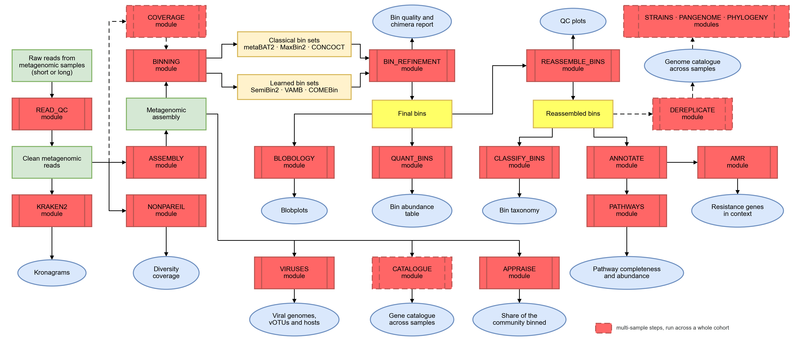
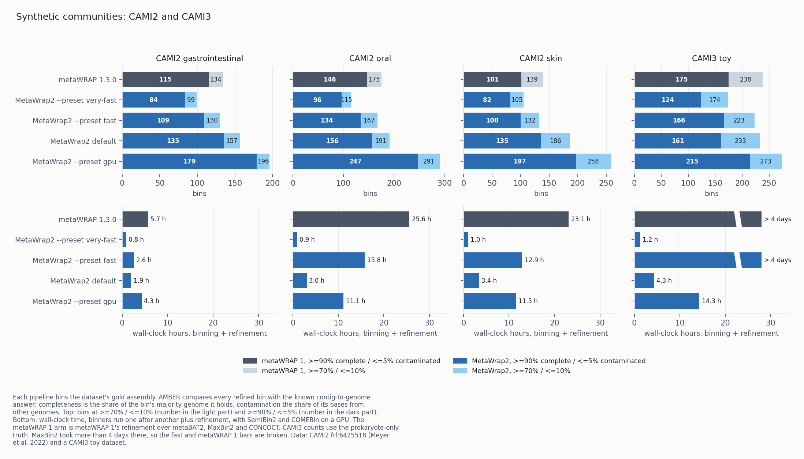

# MetaWrap2: a pipeline for genome-resolved metagenomics

MetaWrap2 is an end-to-end metagenomics pipeline for shotgun sequencing data. It recovers
metagenome-assembled genomes (MAGs) from Illumina short reads or Nanopore and PacBio long reads and
annotates the functions of those genomes and of the rest of the community. On CAMI2 the default
recovers 7% to 34% more near-complete genomes than metaWRAP 1. On the metaWRAP 1 paper's gut
samples it recovers 17% more clean genomes in 1.5 hours instead of 36.5 (on a GPU), and on a single
deeply sequenced sample 31% more. Each default was chosen by a benchmark. One installation covers:

- **Read QC and assembly:** adapter and quality trimming, host read removal, and assembly with
  MEGAHIT, metaSPAdes or metaFlye.
- **Metagenomic binning and bin refinement:** metaBAT2, MaxBin2, CONCOCT, SemiBin2, VAMB and COMEBin,
  on CPU or GPU, with coverage from every sample in a cohort. Bin sets are combined into a better set
  than any single binner, scored with CheckM2 (or CheckM1), filtered for chimeras with GUNC by default,
  and tagged with MIMAG quality tiers.
- **Genome catalogues across samples:** cross-sample coverage, bin reassembly, dereplication into
  one non-redundant MAG catalogue, abundance across samples, and taxonomy with Kraken2 (plus Bracken
  for abundance at a chosen rank) or GTDB-Tk.
- **Functional annotation:** gene calling, KEGG orthologs, KEGG pathway and module completeness,
  Pfam domains, CAZymes, eggNOG orthology (GO terms, EC numbers, COG categories) and biosynthetic
  gene clusters, per genome and per sample. Genes are called once and every search reads the same
  table, so annotations from different databases join on the same gene IDs, including for contigs
  that are in no MAG.
- **Beyond bins:** antimicrobial resistance (AMR) genes with their genomic context, viruses and
  their hosts, strain-level comparison between samples, pangenomes, phylogenetic trees and
  differential abundance.
- **Reports:** one PDF report per run and one row per genome, with MIMAG quality tags and
  static wheels of the functional hierarchy.
- **Tool management:** 55 tools in 16 conda environments that MetaWrap2 builds, checks and runs,
  including tools that cannot share an environment. See [Environments](#environments).

MetaWrap2 is the successor to [metaWRAP](https://github.com/bxlab/metaWRAP), rewritten in Python.
Each module is one file, with the tool commands it runs in a `COMMANDS` block at the top (for
example [`src/metawrap2/modules/binning.py`](src/metawrap2/modules/binning.py)); edit a flag there
to change it.

> Experimental. Interfaces may still change. The benchmarks cover simulated communities and four
> real datasets, so check results on your own data. Coming from metaWRAP 1.x? See
> [Migrating](#migrating).



## Installation

```bash
# 1. mamba, which solves the conda environments much faster than conda. Needs Python 3.10-3.14.
#    No conda on the machine: install Miniforge, which includes mamba and a current Python.
#      curl -L -O https://github.com/conda-forge/miniforge/releases/latest/download/Miniforge3-Linux-x86_64.sh
#      bash Miniforge3-Linux-x86_64.sh -b -p ~/miniforge3 && export PATH="$HOME/miniforge3/bin:$PATH"
#    Anaconda or Miniconda already installed: add mamba to its base environment.
#      conda install -n base -c conda-forge mamba
# 2. MetaWrap2 and its environments.
git clone https://github.com/ursky/MetaWrap2.git && cd MetaWrap2
pip install .                # or: pip install -e .   (to edit the code)
metawrap2 quickstart -t 8    # build the conda environments, then verify each
```

On RHEL 8 or older Ubuntu the system `python3` is 3.9, and `pip install .` fails with
`requires a different Python`. Miniforge provides a current Python.

`quickstart` builds the conda environments with mamba (installing it with conda first if step 1 was
skipped) and checks that each tool runs; see [Environments](#environments). `mamba` must also be
on `PATH` when a module runs. `nohup`, `cron`, `sbatch` and CI jobs often do not set this up; see
[mamba must be on PATH](docs/installation.md#mamba-on-path-at-run-time).

`quickstart --binning-only` installs just what genome recovery needs. If you manage the tools
yourself, set `use_conda_envs = false` in `metawrap2.toml` and MetaWrap2 runs them from your `PATH`.

[docs/tutorial.md](docs/tutorial.md) covers a smoke test that downloads nothing, then MAGs from
CAMI2 samples with a known answer.

The default binners include SemiBin2, which needs pytorch (about 1.5 GB). `quickstart` installs
it. `--preset fast` (metaBAT2 and MaxBin2) does not need it.

### Environments

MetaWrap2 itself is one Python package. The tools it runs live in conda environments that it
builds, checks with `metawrap2 doctor` and selects for each step; you do not activate them
yourself. Tools are grouped by workflow so that shared tools such as samtools are solved once; a tool
gets its own environment when it cannot be solved with the others (inStrain needs Python 3.8,
eggNOG-mapper needs Python below 3.12) or is large and optional.

| Environment | Modules | Tools |
|---|---|---|
| `metawrap2-reads` | read_qc, assembly, reassemble_bins, blobology, nonpareil | fastp, Trim Galore, FastQC, bmtagger, Bowtie 2, SPAdes, MEGAHIT, Flye, QUAST, BLAST, minimap2, BWA, BWA-MEM2, samtools, Nonpareil |
| `metawrap2-bins` | binning, coverage, dereplicate, quant_bins | MetaBAT 2, MaxBin 2, CONCOCT, minimap2, BWA, BWA-MEM2, samtools, skani, sylph, Salmon, CoverM, fairy |
| `metawrap2-learned` | binning | SemiBin2, VAMB, COMEBin (pytorch, CPU or GPU) |
| `metawrap2-binqc` | bin_refinement | CheckM1 (`--checkm1`), pplacer, GUNC, DAS Tool |
| `metawrap2-taxonomy` | classify_bins, kraken2, pathways | Kraken2, Bracken, Krona, taxator-tk, BLAST |
| `metawrap2-annotate` | annotate, catalogue | Prokka, Bakta, dbCAN, GECCO |
| `metawrap2-amr` | amr | AMRFinderPlus, hAMRonization, argNorm |
| `metawrap2-viruses` | viruses | geNomad, CheckV, CCTyper |
| `metawrap2-strains` | strains | inStrain, minimap2, BWA-MEM2, samtools |
| `metawrap2-comparative` | pangenome, phylogeny | PPanGGOLiN, IQ-TREE, FastTree, MAFFT |
| `metawrap2-singlem` | appraise | SingleM |
| `metawrap2-checkm2` | bin_refinement, reassemble_bins (the default bin scorer) | CheckM2 |
| `metawrap2-gtdbtk` *(opt-in)* | `classify_bins --gtdbtk` | GTDB-Tk |
| `metawrap2-eggnog` *(opt-in)* | `annotate --eggnog` | eggNOG-mapper |
| `metawrap2-rgi` *(opt-in)* | `amr --rgi` | RGI |
| `metawrap2-tracs` *(opt-in)* | `strains --backend tracs` | TRACS |

`quickstart` builds the first twelve. An opt-in environment is built with `metawrap2 install-env
<name>` (for example `install-env gtdbtk`), or all of them with `install-env --all`. Gene calling
(Pyrodigal) and the KOfam and Pfam searches (PyHMMER) run in MetaWrap2's own Python, with no
environment. Exact versions are pinned per environment with `install-env --lock`;
[src/metawrap2/envs/](src/metawrap2/envs/README.md) has the details.

## Benchmarks

### Synthetic communities (CAMI2 and CAMI3)

Each pipeline bins the gold assembly of a CAMI2 site or of a CAMI3 toy dataset. AMBER compares every refined bin with the
simulation's true contig-to-genome assignment, so completeness and contamination are measured
against the known answer instead of estimated from marker genes.



| Bins ≥90% complete, ≤5% contaminated (wall-clock time) | metaWRAP 1 | `very-fast` | `fast` | default | `gpu` |
|---|---:|---:|---:|---:|---:|
| CAMI2 gastrointestinal | 115 (5.7 h) | 84 (0.8 h) | 109 (2.6 h) | 135 (1.9 h) | **179** (4.3 h) |
| CAMI2 oral | 146 (25.6 h) | 96 (0.9 h) | 134 (15.8 h) | 156 (3.0 h) | **247** (11.1 h) |
| CAMI2 skin | 101 (23.1 h) | 82 (1.0 h) | 100 (12.9 h) | 135 (3.4 h) | **197** (11.5 h) |
| CAMI3 toy | 175 (> 4 days) | 124 (1.2 h) | 166 (> 4 days) | 161 (4.3 h) | **215** (14.3 h) |

- On the three CAMI2 sites the default recovers 17%, 7% and 34% more of these bins than metaWRAP 1,
  in less time. On CAMI3 it recovers 8% fewer (161 against 175).
- `gpu` recovers more than metaWRAP 1 on all four: 23% more on CAMI3 and 56% to 95% more on CAMI2.
- `very-fast` (metaBAT2 alone) finishes in about an hour and recovers fewer bins than metaWRAP 1 on
  every dataset.
- On CAMI3, MaxBin2 ran for more than 4 days, so `fast` and metaWRAP 1 have no exact time. CAMI3's
  counts use its prokaryote-only truth, since the gold standard also holds the human host and fungi.
- Wall-clock time is binning plus refinement, with binners run one after another and SemiBin2 and
  COMEBin on a GPU. The metaWRAP 1 arm is metaWRAP 1's refinement over metaBAT2, MaxBin2 and
  CONCOCT on the same gold assembly.

AMBER F1 scores and results on each pipeline's own assemblies (scored with
CheckM2 and GUNC) are in [docs/benchmarks.md](docs/benchmarks.md).

### Real samples

Four datasets, each binned by every pipeline from one shared assembly:

- gut and water from the metaWRAP 1 paper: 50 MetaHIT gut samples and 36 Baltic Sea water samples,
  one MEGAHIT co-assembly each;
- one deeply sequenced gut sample from the Hadza cohort (ERR7745335, its published assembly);
- a faecal-transplant series of three samples (donor, recipient before and after), one MEGAHIT
  co-assembly.

Refinement is at `-c 70 -x 10` for all pipelines. Real samples have no known answer, so every final
bin set is scored with CheckM2, and with GUNC for the clean count.


| Clean MAGs (wall-clock time) | Gut, 50 samples | Water, 36 samples | Gut, 1 sample | Gut, 3 samples |
|---|---:|---:|---:|---:|
| metaWRAP 1 | 94 (36.5 h) | 183 (98.5 h) | 158 (15.4 h) | 72 (5.0 h) |
| MetaWrap2 `very-fast` | 91 (7 min) | 162 (14 min) | 154 (1.2 h)* | 52 (1.3 h)* |
| MetaWrap2 `fast` | 85 (19.6 h) | 182 (45.3 h) | 169 (6.2 h) | 56 (2.3 h) |
| MetaWrap2 default | 110 (1.5 h) | 184 (2.7 h) | 207 (3.0 h) | 78 (2.2 h) |
| MetaWrap2 `gpu` | **125** (6.4 h) | **197** (13.3 h) | **250** (9.5 h) | **111** (4.7 h) |

A clean MAG is ≥70% complete, ≤10% contaminated and passes GUNC; the figure also shows the bins at
≥90% / ≤5%. Wall-clock time is binning plus refinement, with SemiBin2 and COMEBin on a GPU. On the
single and three-sample datasets it includes read alignment; on gut and water all pipelines reused
one set of alignments, so it does not.

- The default recovers more clean MAGs than metaWRAP 1 on all four datasets: 17% more on the
  50-sample gut set, about the same on water (184 against 183), 31% more on the single sample and
  8% more on three samples. It takes 1.5 to 3.0 hours, against 5 to 98.5 for metaWRAP 1.
- `gpu` recovers 8% (water) to 58% (single sample) more clean MAGs than metaWRAP 1.
- The margin is largest on the single sample. metaWRAP 1's three binners use coverage across
  samples; SemiBin2 and COMEBin also learn from sequence composition.
- On three samples the default has fewer ≥90% / ≤5% bins than metaWRAP 1 (36 against 44).
- `very-fast` and `fast` recover fewer clean MAGs than metaWRAP 1 on most datasets. `fast` is slow
  on large co-assemblies because MaxBin2's EM iterations grow with contigs and samples.
- By its own CheckM1 scores, metaWRAP 1 kept 186 bins on the single sample and 87 on three; by
  CheckM2, 174 and 83 of them meet `-c 70 -x 10`.
- \* On the single and three-sample datasets, `very-fast` reused the `fast` arm's metaBAT2 bins
  (they are identical), so its time is that arm's alignment, depth-table and metaBAT2 steps plus
  `very-fast`'s own refinement.

### Refinement speed

`bin_refinement` scores its hybrid bin sets with CheckM2 several at a time when memory allows
(`--checkm-jobs`, about 24 GB per CheckM2 call; with `--checkm1`, 16 GB per call on CheckM1's
reduced tree or 40 GB with `--full-tree`). On a three-binner refinement this takes CheckM2 from 12.2
to 9.0 minutes and CheckM1 on the full tree from 32.8 to 13.3 minutes, with the same final bins.


Methods, figures and open questions are in [docs/benchmarks.md](docs/benchmarks.md).

## Hardware

8 cores and 64 GB of RAM is a reasonable minimum; requirements scale with the data. The figures
below come from the runs' usage records. Steps are reaped with `os.wait4`, which reports their peak
memory, and a step that uses a GPU has its peak VRAM sampled while it runs.

Peak RAM per step on the three CAMI2 skin samples (`--preset default`):

| Step | Peak RAM | Driven by |
|:---|---:|:---|
| `read_qc` | 1.3 GB | streaming, so read volume barely matters |
| `assembly` (MEGAHIT) | 4.1-5.5 GB | the k-mer graph |
| `binning` (metaBAT2 + SemiBin2) | 18.4-21.7 GB | depth tables and the learned binner's model |
| `bin_refinement` (CheckM2 + GUNC) | 34.0-34.1 GB | the two reference databases |

These settings affect memory more than the sample does:

- **Assembler.** On three co-assembled CAMI2 gastrointestinal samples metaSPAdes peaked at 140 GB
  and MEGAHIT at 15 GB; metaSPAdes gave a 38% longer N50. `assembly -m` sets the ceiling.
- **Co-assembly.** It holds every sample's reads at once, so memory grows with the study.
  Per-sample assembly with `cohort` avoids this.
- **GTDB-Tk.** `classify_bins --gtdbtk` needs about 140 GB for `classify_wf`, by GTDB-Tk's own
  documentation.

### GPUs

GPUs are optional. Only the three learned binners can use one (SemiBin2, VAMB and COMEBin, in the
`learned` environment). They default to the CPU (`--device cpu`) so that results are the same on any
machine, except under `--preset gpu`, which trains SemiBin2 and COMEBin with `--device cuda`.
`--device cuda` or `--device auto` turns the GPU on for any binner, and an explicit `--device`
overrides the preset.

Peak VRAM on a single device, sampled every 5 s on NVIDIA GPUs:

| Binner | Peak VRAM | Measured on | Grows with the assembly |
|:---|---:|:---|:---|
| VAMB | 0.56 GB | MetaHIT, 16,527 contigs | not measured |
| SemiBin2 | 0.41-2.75 GB | CAMI2 skin, 16,936 and 63,376 contigs | yes, faster than linearly |
| COMEBin | 5.71 GB | the same two skin samples | no, set by batch size |

An 8 GB card runs all three on this data. For assemblies larger than these, allow more than
2.75 GB for SemiBin2. COMEBin, which `--preset gpu` adds, needs the most VRAM and gains the most
from a GPU. On CPU it ran for over 280 CPU-hours on three CAMI2 samples without finishing; metaBAT2
and MaxBin2 together took 7.1 CPU-hours.

The per-step cost line and `.metawrap2/run_steps/manifest.json` of each run give peak memory, CPU
time and, for a GPU step, `peak_gpu_memory_bytes`.

## Databases

Each database is needed only by the modules listed against it. Nothing is downloaded until you run
`install-db`.

```bash
metawrap2 install-db --list                          # every database, its size, and its users
metawrap2 install-db checkm2 gunc host --small -t 3  # enough to recover genomes
metawrap2 install-db --all --dir /data/metawrap2_dbs # install somewhere other than ~/metawrap2_dbs
```

Each installed path is written to `~/.metawrap2/config.toml` (or the file `--config` or
`$METAWRAP2_CONFIG` names), and later runs read the paths from there.

| Database | Size | `--small` size | Used by |
|:---|:---:|:---:|:---|
| CheckM2 (`checkm2`) | ~3 GB | – | `bin_refinement`, `reassemble_bins`, `binning --run-checkm` |
| CheckM1 (`checkm`) | ~1.4 GB | – | `bin_refinement` and `binning --run-checkm` with `--checkm1` |
| GUNC (`gunc`) | ~13 GB | – | `bin_refinement`, unless `--skip-gunc` |
| KRAKEN2 standard (`kraken2`) | ~90 GB | 8 GB | `kraken2`, and `--bracken` (the k-mer distributions ship with it) |
| NCBI nt (`blast`) | ~300 GB | ~2 GB | `blobology`, `classify_bins` |
| NCBI taxonomy (`taxdump`) | ~550 MB | – | `blobology`, `classify_bins` |
| Indexed host genome (`host`) | ~20 GB | ~9 GB | `read_qc` |
| KOfam profiles and thresholds (`kofam`) | ~1.5 GB | – | `annotate --kofam` |
| KEGG BRITE hierarchy (`kegg`) | ~4 MB | – | `pathways` hierarchy and Krona charts |
| Pfam-A (`pfam`) | 1.6 GB | – | `annotate --pfam` |
| eggNOG 5.0.2 (`eggnog`) | 48 GB | – | `annotate --eggnog` |
| dbCAN (`dbcan`) | ~7.4 GB | – | `annotate --cazy` |
| Bakta (`bakta`) | ~30 GB | 1.3 GB | `annotate --bakta` |
| AMRFinderPlus (`amrfinder`) | ~200 MB | – | `amr` |
| CARD (`card`) | ~4 MB | – | `amr --rgi` |
| geNomad (`genomad`) | ~1.5 GB | – | `viruses`, `amr --mobile-elements` |
| CheckV (`checkv`) | ~6.4 GB | – | `viruses` |
| SingleM metapackage (`singlem`) | 9.7 GB | – | `appraise` |
| GTDB-Tk (`gtdbtk`) | ~110 GB | – | `classify_bins --gtdbtk` |
| **everything** | **~644 GB** | **~172 GB** | |

`install-db --list` prints the current version of this table.

- Sizes are on disk after unpacking and indexing; downloads are smaller for some (GUNC 6.7 GB,
  SingleM 2.2 GB, eggNOG 12 GB). `~` marks an estimate, and the total is a lower bound. The
  `--small` column gives the download size of the smaller variant; its total is what
  `install-db --small` downloads for everything.
- `–` in the `--small` column means there is no smaller variant; `--small` installs the full
  database.
- SingleM downloads from Zenodo at 150-300 KB/s and takes 2 to 4 hours. GTDB-Tk needs about twice
  its size free while it unpacks.

For the five databases fetched by a tool's own downloader (`amrfinder`, `genomad`, `checkv`,
`bakta`, `gtdbtk`), `install-db` runs that downloader in the tool's environment, records the path in
your config, and skips it on a re-run.

## Running

Every module runs on its own; `metawrap2 <module> --help` lists its options. A typical
genome-recovery run:

```bash
metawrap2 read_qc -1 reads_1.fastq.gz -2 reads_2.fastq.gz -o READ_QC -t 24
metawrap2 assembly -1 READ_QC/final_pure_reads_1.fastq -2 READ_QC/final_pure_reads_2.fastq \
    -o ASSEMBLY -t 24 -m 64 --metaspades
metawrap2 binning READ_QC/final_pure_reads_1.fastq READ_QC/final_pure_reads_2.fastq \
    -a ASSEMBLY/final_assembly.fasta -o INITIAL_BINNING -t 24 --preset default
metawrap2 bin_refinement -o BIN_REFINEMENT -t 24 -c 70 -x 10 \
    -A INITIAL_BINNING/metabat2_bins -B INITIAL_BINNING/semibin2_bins
```

Each step reads the output of the previous one. Give `binning` the QC'd reads (as positional
arguments): leftover host and adapter sequence distorts the coverage the binners cluster on.

Read files can be gzip- or bzip2-compressed. Pairs are recognised as `_1/_2`, `_R1/_R2`,
`_R1_001/_R2_001` or `.1/.2`. `bin_refinement` accepts up to six bin directories from any binner;
an empty one is skipped with a warning.

`bin_refinement` writes its final set to `metawrap_<completeness>_<contamination>_bins/`
(`metawrap_70_10_bins/` at the defaults). Bins are named `bin_001.fasta`, and the `.stats.tsv` beside
each bin folder gives completeness, contamination (CheckM2's, or CheckM1's with `--checkm1`), GC,
lineage, N50, MIMAG tier and the GUNC result (`gunc_css`, `gunc_pass`) per bin, so counting clean
MAGs needs no separate CheckM2 or GUNC run.

For a whole study, list the samples in a sample sheet and run every module from it with `run` or
`cohort`. `cohort` is `run --no-coassembly`.

| | `run` | `cohort` |
|---|---|---|
| Assembly | one, from all the reads | one per sample |
| Binning | once, on the co-assembly | once per sample, from one cohort-wide alignment (a depth-table slice and per-assembly BAMs) |
| Result | one bin set | one non-redundant genome catalogue (`MAG_CATALOGUE/`) |

Use `cohort` for more than a few samples: a co-assembly loads every sample's reads at once and runs
out of memory as a study grows. Per-sample assembly keeps each bin traceable to its sample. `cohort`
measures coverage across all samples in one pass and dereplicates the per-sample bins, so the
catalogue has one entry per organism.

```bash
metawrap2 cohort --example > samples.toml           # a commented sheet to edit
metawrap2 cohort samples.toml -o study/ -t 32 -j 4
```

`run` follows the sheet's `coassemble` setting. `cohort` overrides it with a warning. Both can
resume from the last finished step. [docs/usage.md](docs/usage.md) covers the extra cohort steps and
the sheet format.

Global options go before the module name:

```bash
metawrap2 --dry-run   binning -a asm.fa -o out ...   # print the commands, run nothing
metawrap2 --resume    binning -a asm.fa -o out ...   # skip steps whose outputs are still valid
metawrap2 --force     binning -a asm.fa -o out ...   # overwrite an existing output directory
metawrap2 --max-threads 32  ...                      # a thread ceiling for the whole run
```

## Modules

| | Module | What it does |
|---|---|---|
| Reads | `read_qc` | Trimming (fastp or Trim Galore) and host read removal |
| | `assembly` | Assembly with MEGAHIT or metaSPAdes, or metaFlye for long reads |
| | `kraken2` | Taxonomic profile of reads or contigs, with `--bracken` for abundance at a chosen rank |
| | `nonpareil` | How much of each sample's diversity was sequenced, and whether samples are comparable |
| Genomes | `binning` | metaBAT2, MaxBin2, CONCOCT, SemiBin2, VAMB and COMEBin; long-read and multi-split modes |
| | `coverage` | One depth table across all samples of a cohort |
| | `bin_refinement` | Combines several bin sets into a better one and checks for chimeras |
| | `reassemble_bins` | Reassembles each bin from its own reads |
| | `dereplicate` | Collapses bins from many samples into one non-redundant catalogue |
| | `quant_bins` | Bin abundance in each sample (sylph, salmon, CoverM or the depth table) |
| | `classify_bins` | Taxonomy for each bin |
| | `appraise` | What share of the community the bins represent, and which lineages are missing |
| | `blobology` | GC-versus-abundance plots of contigs and bins |
| Function | `annotate` | Gene calling on bins or a whole assembly, with KEGG orthologs, Pfam domains, CAZymes, eggNOG orthology and biosynthetic gene clusters |
| | `pathways` | KEGG module completeness and the functional hierarchy, per genome and per sample, with Krona charts |
| | `quantify_function` | Gene and pathway abundance per sample |
| | `catalogue` | A non-redundant gene catalogue across samples, annotated once and quantified by read mapping |
| | `amr` | Resistance and virulence genes with their genomic context and an evidence level (AMRFinderPlus and/or RGI) |
| | `diff_abundance` | Features that differ between sample groups, tested compositionally (ANCOM-BC) |
| Beyond bins | `viruses` | Viral contigs, their completeness, vOTUs and CRISPR-predicted hosts |
| | `strains` | Within-population variation and strain sharing between samples (inStrain and/or TRACS) |
| | `pangenome` | A pangenome for each species in a cohort |
| | `phylogeny` | A tree from a marker or core-gene alignment, with support values |
| Reading the result | `report` | One PDF for a finished run, plus one row per genome (`mag_table.tsv`) |
| | `score` | Scores any directories of genomes (CheckM2, GUNC, MIMAG) into one comparison table, for example another pipeline's bins |

`annotate_bins` still runs but is deprecated in favour of `annotate`. The taxator-tk route in
`classify_bins` is deprecated in favour of `--gtdbtk`.

Bin quality is scored with CheckM2 by default, in `bin_refinement`, `reassemble_bins`,
`binning --run-checkm` and `score`. CheckM2 needs less memory than CheckM1 on its full genome tree
(pplacer holds about 34 GB per call), is faster, and scored the final bins in the MetaWrap2
benchmarks. `--checkm1` scores with CheckM1 and needs `metawrap2 install-db checkm`; in
`bin_refinement` and `binning` it uses CheckM1's reduced tree unless `--full-tree`.
`reassemble_bins` scores with CheckM2 only. `classify_bins --gtdbtk` and `annotate --bakta` are
opt-in engines.

`bin_refinement` and `reassemble_bins` use metaWRAP's algorithms unchanged, checked by
[golden tests](tests/test_bin_refinement_golden.py).

`--preset {very-fast,fast,default,gpu}` selects a set of binners by compute budget (`gpu` was
called `slow` in 2.1.3 and earlier, and `slow` still works). Binners named on the command line take
precedence. Learned binners train on the CPU unless you pass `--device cuda` or `--device auto`
(see [GPUs](#gpus)).

## Release notes

Each release has a page in [releases/](releases/): what it added, which defaults changed and why,
and what is still open. The current release is [2.1.4](releases/2.1.4.md).

## Migrating

Most changes are renames. `metawrap2 config migrate <old-config>` converts a metaWRAP 1 shell
config.

- The command is `metawrap2` (also installed as `mw2`). Module names are unchanged. The config file
  is `metawrap2.toml`.
- Tools run in conda environments created by `metawrap2 quickstart`.
- The `kraken` (KRAKEN1) module and `--metabat1` are gone; use `kraken2` and `--metabat2`.
- `.stats` and `.contigs` files are now `.stats.tsv` and `.contigs.tsv`, with the same contents.
  Bins are `bin_001.fasta` for every binner, so a script that globs `*.fa` needs `*.fasta`.
- Five defaults changed, each based on a measurement in [docs/benchmarks.md](docs/benchmarks.md).
  To reproduce a metaWRAP 1 result:

  | | MetaWrap2 default | metaWRAP 1 behaviour |
  |---|---|---|
  | Trimming | fastp | `--trimmer trim-galore`, or `--fastp-quality-trim` to make fastp trim rather than filter |
  | Bin abundance | sylph | `--quantifier salmon` |
  | Binners | metaBAT2 + SemiBin2 | `--preset fast` (metaBAT2 + MaxBin2) |
  | Depth-table identity floor | 90% | `--min-identity 97` |
  | Bin scorer | CheckM2 | `--checkm1` |

- GUNC runs on the final bins and flags chimeric ones. With `--skip-gunc` it does not run and its
  database is not needed.

## Other changes from metaWRAP 1

Binning
- Six binners, three of them learned (SemiBin2, VAMB, COMEBin), selected by `--preset` tiers, each
  benchmarked end to end. `--preset gpu` refines three complementary bin sets.
- GUNC chimera filtering is on by default. A chimeric bin can score as complete and clean in CheckM;
  the clean counts above include only bins that pass both.
- `reassemble_bins` keeps the original bin when reassembly does not improve it, and every refined
  set carries MIMAG tags.

Benchmarking
- `metawrap2 benchmark` runs a comparison against a dataset with a known answer and writes the
  result to a committed table. Comparisons are TOML entries in `benchmarks/configurations.toml`.
- Cost is measured in CPU-hours.

Cohorts
- `metawrap2 run` and `cohort` execute a whole study from a sample sheet, step by step.
- `metawrap2 coverage` gives every binner each contig's depth in every sample, with one alignment
  per sample. Cross-sample coverage separates genomes that have the same abundance within one
  sample.
- `metawrap2 dereplicate` collapses per-sample bins into one catalogue of organisms.

Function and AMR
- `annotate` calls genes once, on bins or on the whole assembly, and later modules read the same
  table. Annotating the assembly also covers contigs that are in no MAG.
- `pathways` computes KEGG module completeness and reports it under both published definitions,
  since published tools disagree. Each score carries flags for cases where completeness can mislead:
  a reaction with no KO, KOs shared with many other modules, or a route search that was cut short.
- Sample-level function can be weighted by MAG abundance, contig depth or gene abundance, and every
  table says which was used.
- KOfam, Pfam and eggNOG run over the same proteins and are written side by side; where two
  disagree, both calls are kept and the overlap is printed.
- `amr` reports each resistance call with its genomic context and an evidence level. Its two
  backends are joined on ARO terms.

Installation
- `metawrap2 install-db` downloads, unpacks, indexes and configures databases (`--small` for test
  sizes).
- `metawrap2 doctor` reports, per module, whether its environment and tools are installed, missing
  or broken, and whether its databases are complete. `--fix` rebuilds only what is broken.
- Lockfiles (`install-env --lock` and `--from-lock`) pin every package build for reproducible
  environments.

Running and resuming
- Read layouts beyond metaWRAP's `_1.fastq`/`_2.fastq` are detected automatically, and
  `--single-end` and `--interleaved` are supported.
- `--resume` skips a step if it finished, its outputs are present and non-empty, and its inputs
  are unchanged. `metawrap2 status <dir>` shows what a resume would do.
- Inputs are checked before a tool starts (empty file, wrong format, truncated gzip).
  `--skip-validation` turns the checks off.
- Ctrl-C, SIGTERM and SIGHUP mark the running step as interrupted, so `--resume` redoes it. A lock
  file stops two runs from writing to the same directory.

Resources
- One resource budget per run (`--max-threads`, `--max-memory-gb`, `--max-gpus`, or `[limits]` in
  the config), by default a share of the machine. Peak memory is recorded for every step.
- A disk-space check before each step stops a run before it fills the disk. One scratch setting
  (`scratch_dir` or `$METAWRAP2_SCRATCH`) applies to every module.
- `metawrap2 calibrate` compares the built-in disk and memory estimates with real runs.

Provenance
- Every run writes `run_config.json` (parameters, commands and tool versions), `run_commands.txt`,
  `provenance.txt` (carried through chained runs), `run_environment.json` (the full conda package
  list) and `metawrap2.log`.
- `metawrap2 history` logs every run on the machine, and `history --diff RUN RUN` compares two.
- Tool output is shown live and saved, with progress bars and repeated messages collapsed
  (`--verbose-logs` keeps everything). A step with no output for 60 s prints its elapsed time and
  the tool's last line (`--heartbeat-seconds N`, 0 to turn it off). On Linux, a step that keeps
  few of its threads busy prints a warning while it runs.

Code
- The repository is Python only, with no shell, Perl or R scripts. CI checks this.
- Every command's `--help` shows its defaults and accepted values.

## Notes

- Measured CPU, RAM and VRAM requirements are in [Hardware](#hardware). Linux x64 is supported and
  macOS works. Python 3.10 or later is required.
- To change what a module runs, edit the `COMMANDS` or `CONSTANTS` block at the top of its file, or
  override settings in `~/.metawrap2/config.toml`.
- Development setup is in [CONTRIBUTING.md](CONTRIBUTING.md); planned work is in
  [PLANNED_FEATURES.md](PLANNED_FEATURES.md).
- When reporting a bug, include the output of `metawrap2 -v`, the full error, and the run's
  `metawrap2.log`.

## Authors and citation

MetaWrap2 is developed by [Gherman Uritskiy](https://www.linkedin.com/in/gherman-uritskiy-phd-978075b8/)
and [Michael Schatz](http://schatz-lab.org/) (Johns Hopkins University).

There is no MetaWrap2 paper yet. Until there is, please cite metaWRAP:
Uritskiy GV, DiRuggiero J, Taylor J. *MetaWRAP — a flexible pipeline for genome-resolved metagenomic
data analysis.* Microbiome (2018).
[doi:10.1186/s40168-018-0541-1](https://microbiomejournal.biomedcentral.com/articles/10.1186/s40168-018-0541-1)

Please also cite the tools your analysis relied on, such as metaBAT2, SemiBin2, MaxBin2, CONCOCT,
SPAdes, MEGAHIT, Kraken2, CheckM, GUNC, eggNOG-mapper and sylph.
