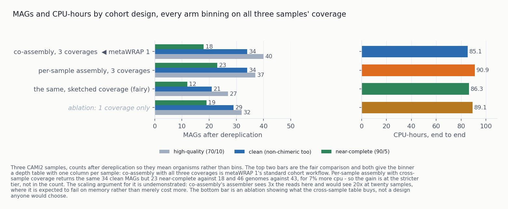
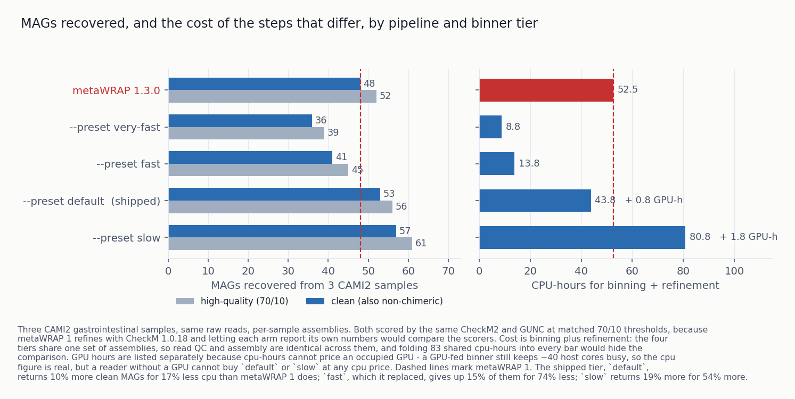
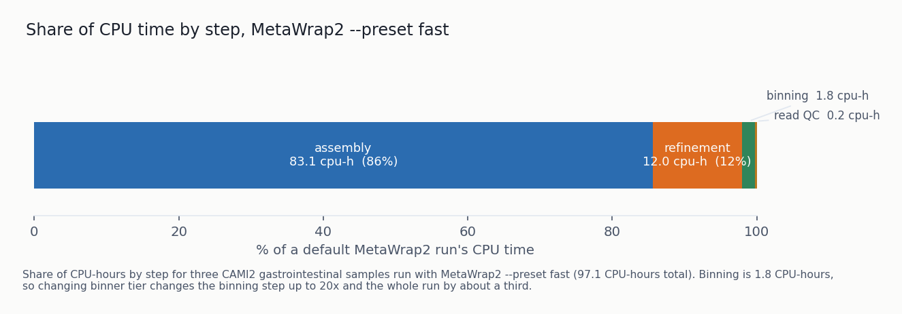
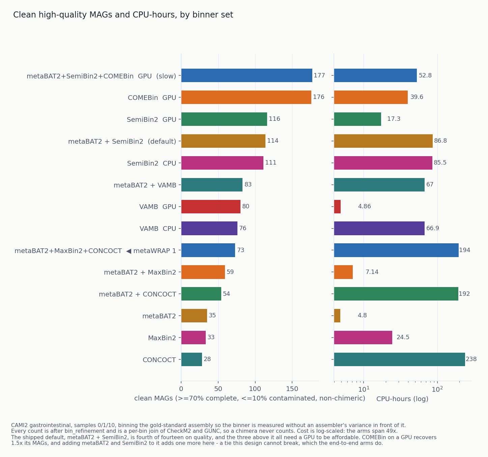
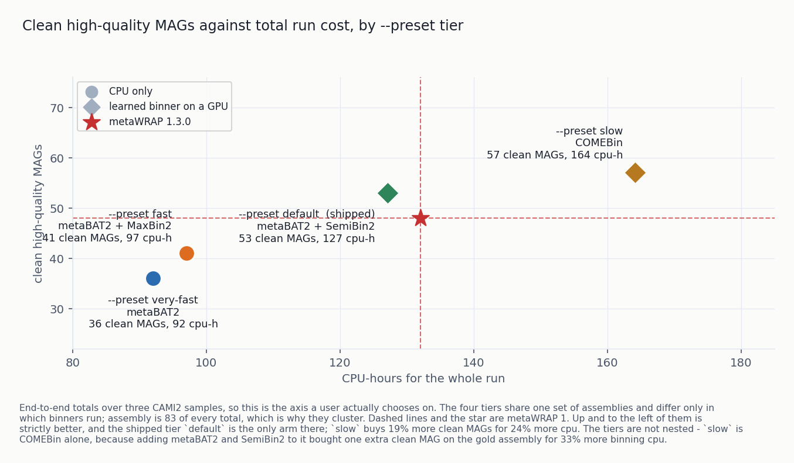
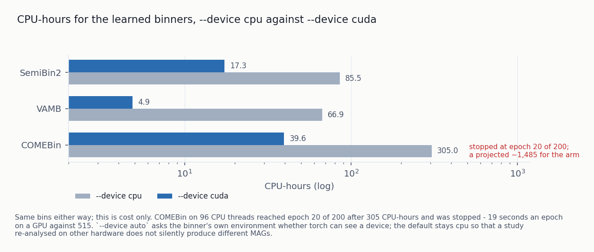
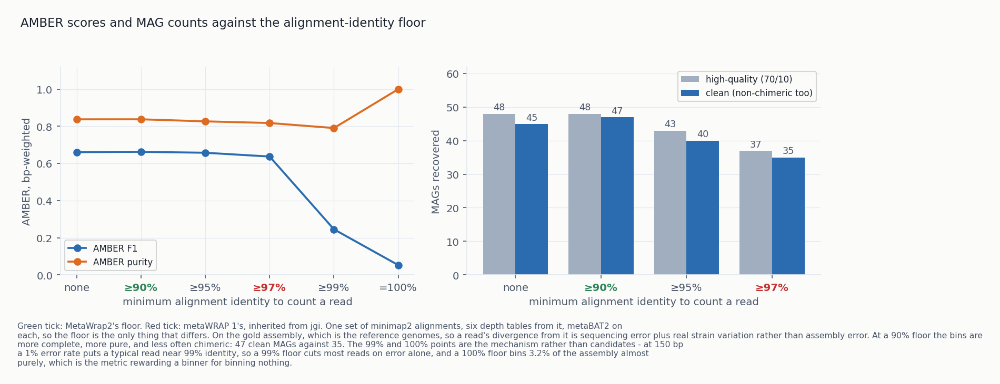
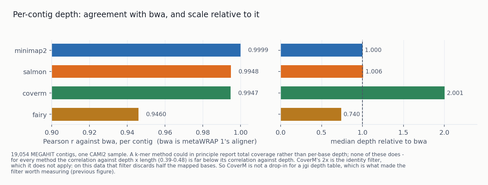
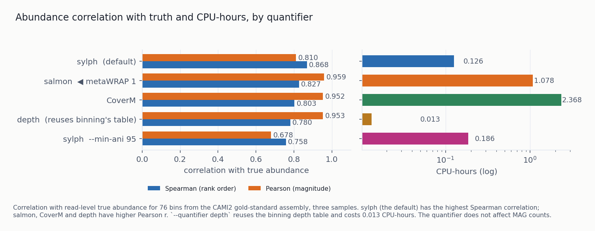

# Benchmarks

MetaWrap2 is a Python-native rewrite of metaWRAP. This page lists what it adds over metaWRAP 1 and
the measured effect of each addition. metaWRAP 1.3.0 is the baseline throughout.

| | metaWRAP 1.3.0 | MetaWrap2 |
|---|---|---|
| cohort runs | one sample at a time, by hand | `run` / `cohort` from a sheet, resumable per step |
| cross-sample coverage | none | `coverage`: one depth table, N alignments instead of N² |
| dereplication | none | `dereplicate`: a cohort's bins collapsed to organisms |
| binners | metaBAT2, MaxBin2, CONCOCT | those three plus SemiBin2, VAMB, COMEBin, GPU-capable |
| which binners run | one fixed set | four `--preset` tiers, 35 to 176 clean MAGs |
| depth table | `jgi_summarize_bam_contig_depths` | own implementation; identity floor measured and moved |
| chimera detection | none | GUNC on every final bin set, on by default |
| consolidation | CheckM on every combination | same, minus repeat and ruled-out calls |
| bin abundance | salmon | sylph default, four quantifiers measured |
| read capping for reassembly | none | `--max-coverage`, default 50× |
| defaults chosen by | the author | `metawrap2 benchmark`, results committed |
| install | one env, manual | 9 workflow envs, `install-env` / `install-db` / `doctor` |

---

# Methods

Data. CAMI2 human microbiome challenge, gastrointestinal, short read. Three samples (0, 1, 10) unless
stated. CAMI2 ships a pooled gold-standard assembly and a contig-to-genome truth table, which makes both
designs below possible.

Two designs. Results from one are not comparable with the other, and no figure here mixes them.

- End-to-end arms give each pipeline the same raw reads and let it assemble its own. This measures
  what a user gets, and is the design used for the metaWRAP 1 comparison. AMBER cannot score these: its
  truth refers to CAMI2's pooled gold assembly, and self-assembled contig names do not appear in it.
- Binner arms bin the gold assembly directly. This isolates the binner from assembler variance and
  allows AMBER.

Quality. CheckM2 scores bins into MIMAG tiers (near-complete ≥90% complete / ≤5% contaminated,
high-quality ≥70/≤10) and GUNC scores chimerism. The headline metric is clean high-quality MAGs: bins
that are both ≥70/≤10 and non-chimeric, counted by joining the two reports per bin. Multiplying an HQ
count by a GUNC pass fraction gives a different number: GUNC runs per bin set, so the pass rate over raw
binner output includes bins that were never candidates. That method understated one arm by 18 genomes.

The same CheckM2 and GUNC score every arm of a comparison. metaWRAP 1 refines with CheckM 1.0.18, which
reports different completeness for the same genome, so each arm's own scores would not be comparable.

Where AMBER applies, it adds bp-weighted F1, purity and completeness against the truth table. Because
AMBER purity is bp-weighted, a bin that is 95% one genome and 5% another loses little purity, so AMBER is
always reported together with GUNC.

Cost. CPU-hours, measured by reaping the child with `os.wait4`. Wall time is not used because it
depends on how many cores a tool is given. Module runs outside the harness record no cost and are not
used. Cost is reported next to quality, not as a ratio. A quality-per-cost ratio favours the cheapest
arm, and ranking on one previously selected a default that recovers fewer genomes than metaWRAP 1.

Harness. `metawrap2 benchmark list|fetch|run|score`. Comparisons are declared in
`benchmarks/configurations.toml`, so adding an arm is a TOML entry. Results go to a committed TSV, so a
change of default is reviewed together with its numbers. `fetch` verifies checksums, runs only when
asked, and refuses to cross a disk ceiling.

Baseline. metaWRAP 1.3.0 from its own conda environment at the versions its recipe pins: metaBAT2
2.12.1, MaxBin2 2.2.5, CheckM 1.0.18, bwa 0.7.18, Python 2.7.15.

---

# Results

## 1. Cohort support

metaWRAP 1 processes one sample at a time, by hand. MetaWrap2 adds three features for cohorts
(`run`/`cohort`, `coverage` and `dereplicate`), the largest functional difference between the two.

`metawrap2 run` / `cohort` execute a study sheet: samples, read paths, steps, per-module options. State
is a per-step manifest fingerprinted on inputs, so `--resume` reruns only the steps whose inputs changed.
A 90-CPU-hour study that fails in refinement resumes at refinement.

`metawrap2 coverage` gives each contig's depth in every sample, which lets the binner separate two
genomes with similar abundance in one sample. It needs N alignments instead of N² and writes one table
that the binners read.

The top two bars are the comparison; both give the binner one depth column per sample. Co-assembly with
every sample's coverage is metaWRAP 1's standard cohort workflow and is the baseline.

| | clean MAGs | near-complete | genomes | CPU-h |
|---|---|---|---|---|
| co-assembly, 3 coverages *(metaWRAP 1's workflow)* | 34 | 18 | 43 | 85.1 |
| per-sample assembly, 3 coverages *(`coverage`)* | 34 | **23** | **46** | 90.9 |

Clean high-quality MAGs are equal. Per-sample assembly gives 23 near-complete against 18 and 46
organisms against 43, for 7% more CPU, and each sample's bins stay attributable to that sample.

Scaling is untested. Co-assembly's assembler sees 3× the reads here and would see 20× at twenty samples,
where it is expected to run out of memory. For small cohorts co-assembly is reasonable; set
`coassemble = true` in a sheet.

The bottom bar is an ablation with one coverage column instead of three: 29 clean MAGs against 34, and
19 near-complete against 23. Building the table costs 2.26 CPU-hours and saves 1.2 in binning, which
reads the table instead of aligning.

`--coverage fairy` (k-mer sketches instead of alignments) makes the coverage step 53× cheaper and loses
13 of 34 clean MAGs. That step is 2.5% of the pipeline, so fairy is not the default.

`metawrap2 dereplicate` collapses a cohort's per-sample bin sets into one catalogue of organisms. Every
cohort figure here is post-dereplication.

## 2. End-to-end comparison with metaWRAP 1

| arm | high-quality | clean | CPU-h *(binning + refinement)* | GPU-h |
|---|---|---|---|---|
| `--preset very-fast` | 39 | 36 | **8.8** | - |
| `--preset fast` | 45 | 41 | 13.8 | - |
| **metaWRAP 1.3.0** | **52** | **48** | **52.5** | - |
| `--preset default` | 56 | **53** | **43.8** | 0.6 |
| `--preset slow` | 64 | **60** | 120.7 | 2.4 |

Cost is binning plus refinement. All tiers use the same assemblies, which cost 83 CPU-hours; including
them would reduce a 6× spread to 1.8×. CPU-hours come from the driver wrapping every step in
`os.wait4`. GPU-hours (the wall time of binners run with `--device cuda`) are listed separately. A
binner on a GPU still keeps ~40 host cores busy, and the CPU-hours shown for `default` and `slow`
require a GPU.

These costs are for CAMI2 (3 samples, 17-63k contigs) and do not scale to a large cohort
co-assembly. MaxBin2, almost all of `fast`'s cost, takes longer per EM iteration with more contigs and
samples: about 53 minutes per iteration on a 418k-contig co-assembly of 36 samples, so its default
50 iterations take about 40 hours, against 13.8 CPU-hours here. `--maxbin2-max-iteration` sets the
limit. Use the table to compare presets, not to budget a different dataset.

- `default` gives 10% more clean MAGs than metaWRAP 1 for 17% less CPU. It became the default tier on
  2026-10-09.
- `fast`, the previous default, gives 15% fewer clean MAGs than metaWRAP 1 for 74% less CPU. It was
  chosen on a quality-per-cost ratio.
- `slow` gives 25% more clean MAGs than metaWRAP 1 for 130% more CPU. It refines three bin sets: 7
  hybrid combinations against `default`'s 3.

A plain `metawrap2 run` therefore needs `metawrap2-learned`, ~1.5 GB of pytorch, which `quickstart`
builds. `--preset fast` gives the previous behaviour without it.

These are end-to-end numbers. The larger figures in §3 come from CAMI2's gold assembly; on a real
per-sample assembly the tiers are closer together.

Most of the cost difference is in binning, 38.4 CPU-hours against 1.8, from using minimap2 instead of
bwa and two binners instead of three. Refinement is also cheaper, since two bin sets give 3 combinations
to score with CheckM and three give 7.

Assembly is about 65% of a default run (83 of 127.1 CPU-hours) and does not depend on the binners, so
the tier comparison excludes it.

### 2.1 Other body sites

The numbers above are from one body site. The comparison was repeated on CAMI2 oral and skin from the
same deposit and truth format: three samples each, per-sample assembly, both arms scored with CheckM2
and GUNC. Skin is a low-diversity community dominated by a few genera, so it differs from the gut
samples in community structure, not just in site.

| body site, 3 samples | metaWRAP 1.3.0 | `--preset default` | difference | CPU-h end to end, mw1 vs mw2 |
|---|---|---|---|---|
| gastrointestinal | 48 clean (52 HQ) | **53 clean** (56 HQ) | +10% | 132.0 vs 127.1 |
| oral | 45 clean (49 HQ) | **51 clean** (57 HQ) | +13% | 172.6 vs 184.9 |
| skin | 41 clean (48 HQ) | **50 clean** (57 HQ) | +22% | 136.2 vs 200.2 |

The figure also shows `--preset fast` and `--preset slow` on every site. Its
cost panel is binning plus refinement, since the presets share the default arm's assemblies; the
table gives end-to-end CPU-hours.

`default` recovers more clean MAGs on all three sites, most on skin. Per sample it wins five of the
six oral and skin samples and ties one (oral 20/17, 13/10, 18/18; skin 14/10, 17/16, 19/15 clean).

For this table the gastrointestinal arms were re-scored with the per-bin CheckM2 ∩ GUNC join instead of
reusing the older high-quality counts, so all six numbers come from the same scoring. The cost column
cannot be compared between sites. The gastrointestinal arm trained SemiBin2 on a GPU (0.6 GPU-hours)
and the oral and skin arms ran it on the CPU, the default; this accounts for the difference between 32
and 124-139 CPU-hours of binning. Within a site the costs are comparable: against metaWRAP 1,
MetaWrap2 is 4% cheaper on gastrointestinal, 7% more expensive on oral and 47% more expensive on skin,
where it recovers 9 more clean MAGs for 64 more CPU-hours.

### 2.2 Presets on CAMI2 oral

The preset table in §3 is from the gastrointestinal samples only. All presets were also run on the
oral samples, scored with the same per-bin CheckM2 ∩ GUNC join:

| arm | binners | device | clean | HQ | CPU-h *(binning + refinement)* |
|---|---|---|---:|---:|---:|
| `--preset fast` | metaBAT2 + MaxBin2 | cpu | 39 | 50 | **9.4** |
| **metaWRAP 1.3.0** | metaBAT2 + MaxBin2 + CONCOCT | cpu | **45** | 49 | 123.4 |
| `--preset default` | metaBAT2 + SemiBin2 | cpu | 51 | 57 | 132.8 |
| `--preset slow` | + COMEBin | cuda | **59** | 63 | 80.3 |

`slow` recovers 16% more clean MAGs than `default` on oral, against 13% on the gastrointestinal
samples (60 vs 53), and wins on each of the three samples (23/20, 15/13, 21/18). A user-testing run on
MetaHIT reads gave +58%. Making `slow` the default would need its cost measured with SemiBin2 and
COMEBin on CPU, which is what most users have; that has not been measured.

The cost column is binning plus refinement only, since the preset arms reuse the `default` arm's
assemblies. The devices also differ: `default` trained SemiBin2 on CPU and `slow` used a GPU, which
is why `slow` shows fewer CPU-hours. The comparable pair is `fast` and `default`, both on CPU: 9.4
against 132.8 CPU-hours for 39 against 51 clean MAGs. `fast` recovers fewer clean MAGs than metaWRAP
1 (39 against 45) for 7% of its compute.

### 2.3 Presets on CAMI2 skin

| arm | binners | device | clean | HQ | CPU-h *(binning + refinement)* |
|---|---|---|---:|---:|---:|
| `--preset fast` | metaBAT2 + MaxBin2 | cpu | 35 | 41 | **10.7** |
| **metaWRAP 1.3.0** | metaBAT2 + MaxBin2 + CONCOCT | cpu | **41** | 48 | 81.0 |
| `--preset default` | metaBAT2 + SemiBin2 | cpu | 50 | 57 | 147.7 |
| `--preset slow` | + COMEBin | cuda | **54** | 59 | 122.3 |

`slow` recovers 8% more clean MAGs than `default` on skin, against 16% on oral and 13% on
gastrointestinal, so the third binner adds less on the low-diversity community. Per sample it wins
two and ties one (15/14, 17/17, 22/19); on the tie it made one more high-quality bin, which GUNC
failed. `fast` again recovers fewer clean MAGs than metaWRAP 1 (35 against 41), for 13% of its
compute. The same caveats as §2.2 apply. On sample_17, CheckM1 inside `bin_refinement` needed
`--reduced_tree` for COMEBin's bin set, so that sample's choice between hybrid sets used a slightly
different scorer; all counts above come from the shared CheckM2 ∩ GUNC join.

The CAMI2 deposit has two more body sites (airways, urogenital) and PacBio-simulated versions of all
49 samples. Each additional site takes about 10.5 hours of wall time for the two
end-to-end arms.

## 3. Binning

Fourteen arms on the gold assembly, every count after refinement. metaWRAP 1's trio is in the middle.
`slow` recovers 1.55× the clean MAGs of `default` here and 1.13× end to end (§2). Gold-assembly contigs
are long and clean, so this design measures binners on ideal input; §2 measures them on real
assemblies.

On agreement with the truth table, both learned binners beat all three of metaWRAP 1's. CONCOCT scores
third and costs more than everything else combined, so it is opt-in.

### `--preset`

| tier | binners | clean MAGs, end to end | clean MAGs, gold assembly | extra install |
|---|---|---|---|---|
| `very-fast` | metaBAT2 | 36 | 35 | - |
| `fast` | metaBAT2 + MaxBin2 | 41 | 59 | - |
| `default` | metaBAT2 + SemiBin2 | **53** | 114 | `install-env learned` |
| `slow` | metaBAT2 + SemiBin2 + COMEBin | **60** | **177** | `install-env learned` |

`slow` recovers 3× the clean MAGs of `fast` on the gold assembly and about 1.4× on real per-sample
assemblies. A preset never overrides a binner named explicitly.

The tiers are not nested: only `fast` runs MaxBin2. MaxBin2 has the lowest GUNC pass rate measured (37.7%
of its bins), so the higher tiers leave it out. Clean MAG counts rise with each tier in both designs.

In `default`, metaBAT2 reads the depth table SemiBin2 already built and costs ~1.3 CPU-hours. On the gold
assembly the pair gives 114 clean MAGs against SemiBin2's own 116; end to end the pair is kept.

`metawrap2-learned` is one environment holding SemiBin2, VAMB and COMEBin, which are all pytorch
applications that solve together. Its solve pulls a CUDA-capable pytorch, so it serves both
`--device cpu` and `--device cuda`; there is no separate GPU install.

### Binner combinations and `--preset slow`

Refinement keeps the best version of each bin, so in a combination the genomes only one binner finds
count for more than its total. To measure this, each clean
high-quality bin is assigned to the reference genome owning most of its sequence, and unions are taken
over pairs and trios, on the existing gold-assembly bin sets.

| binner | clean MAGs | genomes recovered | of those, found by nothing else |
|---|---|---|---|
| COMEBin | 176 | 176 | **39** |
| SemiBin2 | 116 | 116 | 4 |
| VAMB | 80 | 80 | 0 |
| metaBAT2 | 35 | 35 | 0 |
| MaxBin2 | 33 | 33 | 1 |
| CONCOCT | 28 | 28 | 0 |

The binners overlap heavily, and COMEBin finds most of what the others find. The best pair is
COMEBin + SemiBin2 at 181 genomes; no trio exceeds 182. The best trio is COMEBin + SemiBin2 + MaxBin2
(182); COMEBin + SemiBin2 + metaBAT2 reaches 181.

`slow` uses the metaBAT2 trio. MaxBin2 costs 24.5 CPU-hours here against metaBAT2's ~1.5, and only 37.7%
of its bins pass GUNC. Of the trios within one genome of the best, metaBAT2's is the cheapest by an order
of magnitude, against VAMB's 4.9 GPU-hours, MaxBin2's 24.5 and CONCOCT's 238.

The trio spans three algorithm families: contrastive (COMEBin), self-supervised (SemiBin2), and
composition-plus-coverage (metaBAT2). The union of 182 is an upper bound that assumes refinement picks
the right version of every bin, and one dataset cannot show whether COMEBin's 39 unique genomes
generalise. Using three binners from different families makes the top tier less dependent on any one.

### `--device`

One switch covers all three learned binners, including VAMB. `auto` asks each binner's environment
whether torch can see a device. The default is `cpu`, so re-analysing a study on different hardware
gives the same MAGs. With a GPU `slow` costs 40 CPU-hours; without one it does not finish.

VAMB refuses to start on the gold assembly because it contains 20 records with no A, C, G, T or U
(masked reference genomes, 28.9 Mbp, the largest 6.6 Mbp). metaBAT2, MaxBin2 and CONCOCT accept such a
contig and cannot place it. `binning` and `coverage` drop them.

## 4. Coverage estimation

MetaWrap2 computes its own depth table instead of calling `jgi_summarize_bam_contig_depths`. The
algorithm is the same and agrees with jgi at Pearson 0.9992 on means across all 210,632 CAMI2 contigs.
The reimplementation makes the table testable. The invalid MaxBin2 depths from jgi (§8) were found only by
running the C++ binary twice and comparing, and the identity floor could then be tested.

jgi discards reads below 97% alignment identity. On this strain-rich data a 90% floor gives bins that
are more complete, purer and less often chimeric: 47 clean MAGs against 35, so 97 loses a quarter. The
risk of a lower floor is that a relative's reads inflate a contig's depth and the binner merges two
strains; AMBER purity and GUNC show no such effect here.

The default floor is 90, the only parameter that differs from jgi. `--min-identity 97` reproduces a jgi
table, which is needed to reproduce a metaWRAP 1 result. Measured on one dataset with one binner.

The cheaper alternatives were compared per contig. CoverM reports 2× bwa's depth because it applies no
identity filter, so it cannot directly replace the depth table.

## 5. Refinement

Refinement hybridises every combination of its input bin sets and asks CheckM which version of each bin
to keep: 2ⁿ−1 CheckM runs. Two kinds of call are skipped without changing any result:

- A third of the calls are for a bin already scored, identified by a hash of its sorted contig ids.
  Identical contigs give identical completeness.
- Bins outside 200 kb–20 Mb cannot be ≥70%-complete genomes, and CheckM's cost scales with bases:
  metaBAT2's unbinnable remainder reaches 159 Mb. `--score-everything` disables this filter.

GUNC runs on every final bin set by default. A bin built from halves of two genomes has a complete,
uncontaminated-looking marker set that CheckM accepts. On one arm 4 of 60 final bins are chimeric by GUNC
despite passing CheckM at 70/10. Bins are annotated, never dropped. `--skip-gunc` opts out, along with
its 6.7 GB database. On the same arm the two input bin sets were 12.0% and 36.0% chimeric and the
consolidated set is 6.7%.

`--consolidator dastool` scores input bins once on single-copy genes instead of running CheckM on every
combination. On one sample's per-sample bins, `metawrap` keeps 13 MAGs for 4.52 CPU-hours and DAS Tool
keeps 10 for 0.62. A difference of three genomes on one sample is not enough to change the default.

## 6. Bin abundance

metaWRAP 1 quantifies with salmon. MetaWrap2 offers four quantifiers and defaults to sylph. No
quantifier is best at both ranking and magnitude: sylph ranks bins best and estimates magnitude worst,
salmon the reverse. sylph is the default because abundance tables are mostly used to see which MAGs
dominate and how that changes across samples, which depends on ranking.

`--quantifier depth` aligns nothing: it takes a length-weighted mean per bin from the depth table binning
already wrote. It costs 0.013 CPU-hours, 180× less than CoverM, and ranks second of four on magnitude and
last on ordering. It is the only quantifier that uses the depth values the binner clustered on.

Values are not interchangeable across quantifiers:

- salmon reports a length-weighted median contig coverage, CoverM a percentage of the sample, sylph a
  k-mer sequence abundance.
- A CoverM zero means "mapped, but under `--min-covered-fraction` covered"; a sylph zero means "not
  detected above `--min-ani`".
- MetaWrap2 sets sylph's `--min-ani` to 99 instead of sylph's default 95. At 95, more than half the
  abundance in one sample went to four bins whose genomes are absent from it.

## 7. Smaller changes

`read_qc` trims with fastp: 1.0% more bases and 0.4% more Q30 bases kept for 5.8% less CPU (cutadapt
stops scaling at 4 threads). Trim Galore remains supported and suits memory-constrained machines: it
peaks at 0.1 GB, fastp at 1.4.

`reassemble_bins --max-coverage` (default 50) thins each bin's recruited reads to 50× of that bin's
assembled length, in pairs, with a fixed seed. An abundant organism otherwise hands SPAdes hundreds of
times the coverage it can use, and SPAdes' time grows with reads. `0` keeps every read.

`blobology` no longer uses bowtie2. `--aligner` offers binning's three choices from one shared registry.

`mw2` is the same CLI under a shorter name.

There are nine conda environments; modules that run in sequence and share tools share one. Four are
separate because their solutions conflict: CheckM2 has no common solution with CheckM1 + GUNC + DAS
Tool, and GTDB-Tk none with taxator-tk. GUNC, DAS Tool, CoverM, fairy and Bakta are installed by default.

Every command prints its defaults and accepted values from one formatter across two dozen entry points.
Defaults are read off the parser, and a numeric option declares its range once for both checking and
printing: `-c/--completeness` reads `[0-100] [default: 70]` and rejects `-5`.

## 8. Defects found and fixed

Each produced wrong numbers or lost runs without an error, and each has a regression test.

Pipeline:

- MaxBin2 binned on values from `jgi_summarize_bam_contig_depths --noIntraDepthVariance` that are not
  depths, affecting every bin it produced.
- An all-N contig broke VAMB and was binned by everything else.
- Four modules treated the unbinned leftovers as a candidate genome.
- `--resume` on `bin_refinement` deleted the output it was resuming from and reported success; the same
  two defects were in `reassemble_bins`.
- metaBAT2 had no seed, so identical input did not reproduce.
- A crashed aligner read as a successful run.
- With one input bin set nothing applied the quality thresholds: refining a single COMEBin run left 376
  bins in `metawrap_70_10_bins`, of which 178 pass.
- `reassemble_bins` recruited reads that are not reads and scored unknowns as perfect.
- A study sheet selecting any `--preset` but `fast` failed at refinement: the driver resolved binner
  flags but not presets, and passed refinement two directories that were never created.

Harness:

- No multi-binner arm had been ranked: refinement writes into a subdirectory and the scanner only read
  the variant root.
- A re-score that changed an arm's bin set was added to the old one, so COMEBin's 178 MAGs read as 356.
- Clean-MAG counts were estimated as `HQ × GUNC pass fraction`, which understated COMEBin by 18 genomes
  and reversed a default.
- `benchmark score` run from outside the repository wrote a second results file and reported success.
- AMBER scored one bin set twice as two arms, and was skipped on any variant already through CheckM.
- The ranker summed fractions, so the variant measured on the most samples won.

The following were found in a review of the harness after the results above were produced. Three change
numbers in the committed results table; the affected figures are marked and need re-scoring.

* `read_qc` figures are one mate's count. The scorer wrote one row per mate file, but a measurement is
  keyed on (dataset, comparison, variant, sample, metric), so the two rows collapsed to the last mate
  walked. **`reads_kept`, `bases_kept` and `q30_bases_kept` in §7's trimmer comparison are half the
  real counts.** Both arms are halved identically, so the 1.0%/0.4% margins still hold; the absolute
  numbers do not.
* A refinement arm used only three of its bin sets, alphabetically: the runner zipped the bin
  directories onto `("-A", "-B", "-C")` and `zip` truncates. With
  `comebin/concoct/maxbin2/metabat2/semibin2/vamb` that drops metaBAT2. It also fed a previous
  refinement's output back in as an input set. **Any multi-binner refinement arm above four binners has
  to be re-run**; the arms in §5 use two.
* A crashed variant's partial output was scored and published. Scoring ignored the recorded non-zero
  exit, so bins from a variant that died after its first binner were ranked and listed with cost
  "unmeasured", indistinguishable from a finished arm whose rusage was lost. Failed variants are now
  skipped; `--score-failed` overrides.
* Abundance was scored over the intersection of the table and the truth, so a quantifier that omitted a
  bin was scored on a smaller, easier set. The salmon path writes only rows salmon emitted, while the
  CoverM path pre-seeds one per bin, so arms could be scored over different numbers of bins. Missing
  bins now count as zero and are reported as `abundance_missing_bins`. **§6's ordering result should be
  re-scored**; the gap between sylph and salmon is wide enough that it is unlikely to turn over.
* The depth stream could deadlock. `samtools view | samtools depth` left both stderr pipes unread until
  the depth stream was consumed. One warning per record fills the 64 KiB pipe buffer, samtools blocks,
  and the run hangs with no output and no timeout. Both pipes are now drained concurrently.
* The disk monitor could abort the wrong step. It interrupted the main thread without re-checking
  whether the watched step had finished, so under `run` or `cohort` the `KeyboardInterrupt` landed in
  the next step, and the watched step was reported as a disk stop it never hit.

## 9. Limitations

Mostly one dataset. Everything here except §2.1 to §2.3 is CAMI2 gastrointestinal, mostly three
samples. The identity floor is the change that most needs re-testing elsewhere. A looser floor should matter less on a self-assembled contig set,
because a fragmented consensus already absorbs some of the strain variation the true genomes do not.

Open issues:

- CONCOCT costs ~4× more under MetaWrap2 than under metaWRAP 1 for the same version, the same flags,
  and assemblies agreeing to one contig in 19,054. CONCOCT forks `-t` workers and each one's OpenBLAS
  started one thread per core; capping the numerical libraries to one thread per forked worker recovered
  1.3×. The rest is unexplained; the next candidate is the build: Python 3.12 and scikit-learn 1.9 against
  Python 2.7 and a much older scikit-learn. It does not affect the default path, since CONCOCT is
  opt-in.
- `metabat2_comebin`, the cheap half of the three-binner ensemble, is unmeasured.
- A dereplication comparison needs a scorer that does not exist.
- The cohort-scaling experiment that would settle co-assembly has not been run.
- MetaDecoder and binny are not started.

Open decisions:

1. Should a GPU machine default differently? VAMB on a GPU beats the default tier on every axis
   including cost; COMEBin on a GPU is the best catalogue measured. Neither is a default, because both
   depend on hardware most users do not have.
2. Is moving the identity floor too aggressive on one dataset? It can be reverted in one line. Related and
   unsettled: the floor uses `qlen` as its denominator, which counts soft-clipped and inserted bases,
   where jgi divides by the aligned length alone, so the effective floor is looser than the number
   requested. It agrees with jgi to Pearson 0.9992 on the means, so the aggregate effect is small, but
   tightening it moves every depth table and needs re-measuring.

Decided since: `--preset default` is the default tier (§2), because end to end it beats metaWRAP 1
on both quality and cost.

The test suite passes, ruff, black, isort and mypy are clean over 91 source files, and `doctor` reports
12/12 modules healthy.
