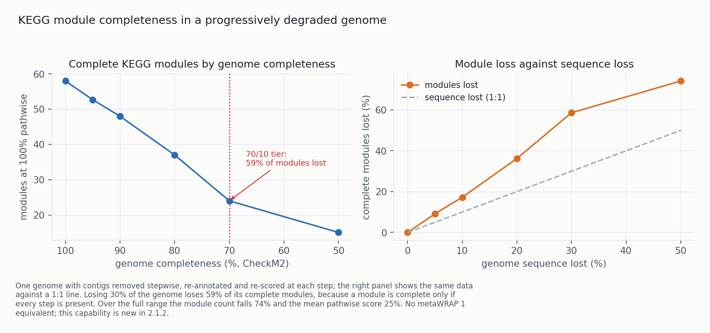
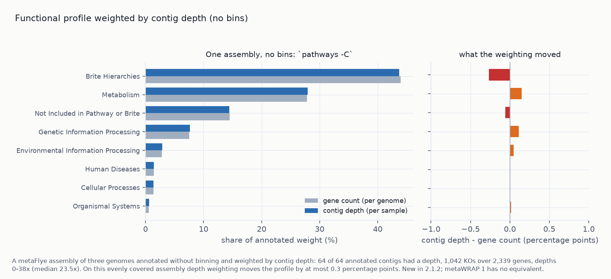
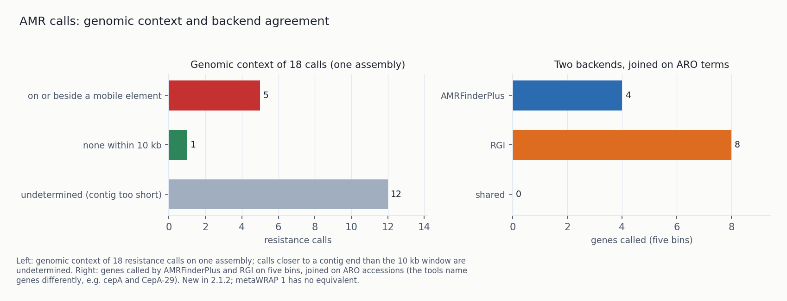
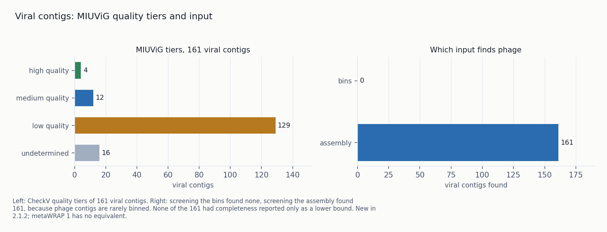
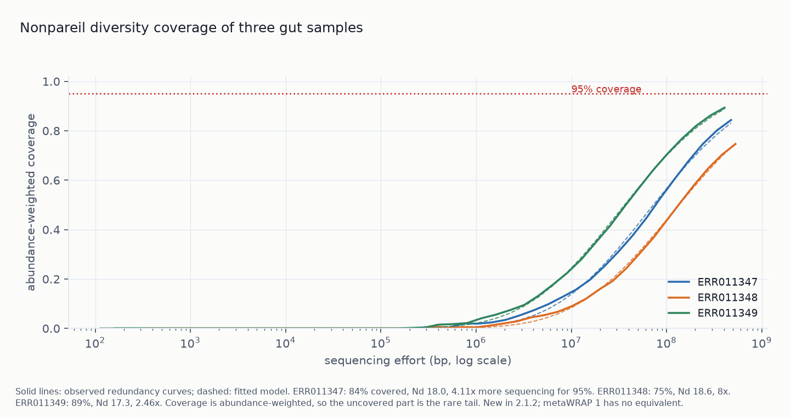
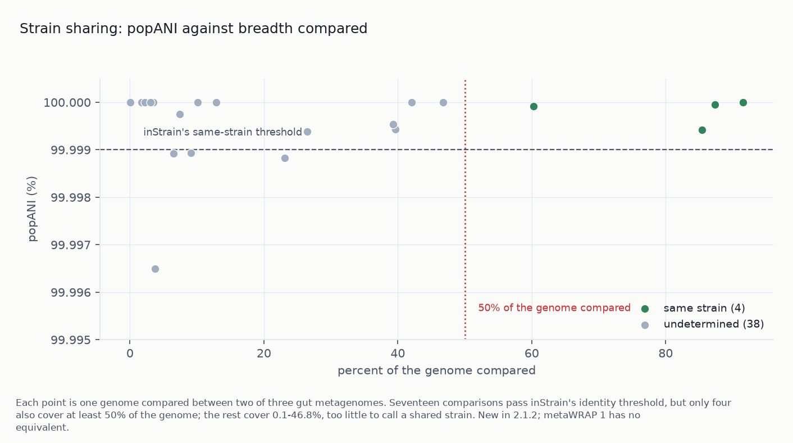
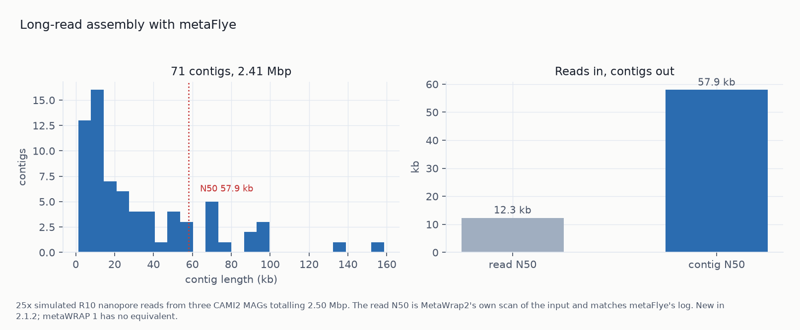
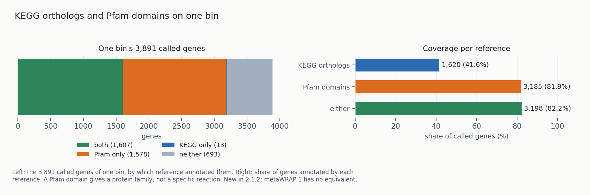

# 2.1.2 - functional annotation, viruses, AMR, strains and long reads

This release adds 13 new or extended modules and flags for functional annotation, viruses,
resistance genes, diversity coverage, strains and long reads. MAG recovery is covered in
[Benchmarks](../docs/benchmarks.md). Each number below can be reproduced from the run's
`run_commands.txt`.

| | before | after |
|---|---|---|
| gene calling | one Prokka run per bin, GFF only | `annotate`: Pyrodigal over bins *or* a bare assembly, one joinable table |
| functional assignment | product names | `annotate --kofam`: KEGG orthologs, per-profile thresholds, score type per profile |
| pathways | none | `pathways`: KEGG module completeness computed here, both definitions, seven caveat flags |
| functional hierarchy | none | gene → chemical process → pathway as percentages, per genome and per sample (by MAG abundance, contig depth, or gene abundance), with Krona wheels |
| sample-level function | none | `quantify_function`: abundance-weighted, three units, BIOM output |
| bin-free path | none | `catalogue`: cross-sample gene catalogue, annotated once, quantified by read mapping |
| resistance | none | `amr`: AMRFinderPlus, genomic context, evidence level, hAMRonization schema, ARO terms |
| ARG context | none | `--mobile-elements`: geNomad proviruses and plasmid contigs, so a call can reach L2 |
| viruses | discarded | `viruses`: geNomad + CheckV + vOTUs + CRISPR host links |
| diversity coverage | none | `nonpareil`: per-sample coverage, Nd, projected effort, cohort comparability verdict |
| unbinned fraction | none | `recovery` (binned bp) and `appraise` (per-cell share, unrepresented lineages) |
| resistance backends | none | `amr --rgi`: RGI against CARD beside AMRFinderPlus, joined on ARO terms |
| strains | none | `strains`: popANI and TRACS transmission distances, both breadth-gated, reported side by side |
| long reads | none | `assembly -L` (metaFlye), `binning --long-read-type`, SemiBin2's long-read mode |
| protein domains | none | `annotate --pfam`: Pfam-A at each family's gathering threshold, 1,578 genes with no KO |
| pangenomes | none | `pangenome`: one per dereplication cluster, with a check on the clustering |
| phylogenies | none | `phylogeny`: IQ-TREE or FastTree over an alignment the pipeline already wrote |
| statistics | none | `diff_abundance`: ANCOM-BC, compositional by default |
| binning | one binner per preset tier | `--preset slow` runs three binners; `--binsplit` for multi-split |

---

# Methods

**Data.** Functional and viral work: CAMI2 human microbiome challenge, gastrointestinal, short read.
One sample's assembly (19,233 contigs) and refined bins, plus five bins as the development set.
Read-level modules: three real human gut metagenomes (ERR011347-9, 10.4-12.0 M read pairs each).

**Controls.** For modules where an error would not show in the output:

- `nonpareil` reimplements a published model and is checked against the original implementation.
- `viruses --crispr-hosts` found no host links, so the matcher is tested on sequence that must
  match.
- `catalogue --quantify` is checked with reads cut from the catalogue itself (must map) and reads
  from an unrelated study (must not).
- `pathways` is checked against a published count of single-step KEGG modules.

**Cost.** Wall time at a stated thread count. The CPU-hour harness (`os.wait4`) is only used when
a default changes, which none of these additions does.

**Caveats** are written into the output: `permitted_language` per ARG row, `effort_unit` per
coverage row, chimerism and unbinned caveats next to bin counts, and `context_unknown` as a state
separate from "searched and found nothing".

---

# Results

## 1. Functional annotation and pathways

`annotate` calls genes once, on a bin folder or a whole assembly, into one table used by all
later steps. On one CAMI2 sample's refined bins it calls 14,171 genes at 76 s per bin, and 5,827
get a curated KEGG ortholog (2,008 distinct KOs).

`annotate_bins` (Prokka per bin) is deprecated. It gave product names only and could not annotate
unbinned contigs, which hold most assembled sequence.

KOfam settings:

- **Score type per profile.** Of KOfam's 28,453 profiles, 17,890 set their bit-score threshold on
  the full-sequence score and 8,697 on the best-domain score. Using one score type for all accepts
  hits KOfam rejects.
- **Profiles without a threshold.** The 1,866 profiles with no threshold are dropped. KEGG module
  M00851 "Carbapenem resistance" is an OR of 21 KOs, one without a threshold, so one permissive hit
  would make it complete. This default matches KofamScan, which had the highest eggNOG confirmation rate (84%) in Kananen et al.
  2025.
- **Relative fallback.** An unannotated gene can take its best hit at a set fraction of the
  profile's threshold, marked `evidence=relative`. On one bin, 0.5× adds 355 calls to 949 curated.

### 1.1 Module completeness and a definition-parser bug

`pathways` computes KEGG module completeness under two definitions: `pathwise` (best route
through the definition) and `stepwise` (fraction of top-level steps satisfied). On the CAMI2 bins
the two disagree on 9.7% of modules at ≥80% (158 against 144 of 2,865 module rows). The five
published tools compared each use a different definition; on the same KOs anvi'o reports 11-12%
more modules at ≥80% than MicrobeAnnotator or KofamScan.

A `+`-joined protein complex is one step that needs all its subunits. Read as seven steps, M00142
(NADH dehydrogenase, seven subunits) scores 3/7 for a genome with three subunits; the correct score
is 0. Counting top-level spaces in the definition string gets the right total of 47 single-step
modules only because two errors cancel (a complex counted as a sequence, a parenthesised group as
one step).

Each module row has seven caveat flags, including: number of top-level steps (47 modules have one,
so completeness is 0 or 100%); signature module or pathway; reactions with no KO (14 modules, which
can never reach 100%); and KOs unique to the module (45 KOs appear in five or more modules).

### 1.2 Module completeness versus MAG completeness

One genome was degraded by removing contigs and re-annotated and re-scored at each step. At 70%
completeness, the high-quality threshold, it has lost 59% of its complete modules:

| genome completeness | complete modules (≥100% pathwise) |
|---|---|
| 100% | 58 |
| 95% | 52.7 |
| 90% | 48.0 |
| 80% | 37.0 |
| 70% | 24.0 |
| 50% | 15.0 |

Complete modules are lost about twice as fast as sequence, since every step must be present.
Over the range the mean pathwise score falls 25% and complete modules 74%. `modules.tsv` includes
the genome's CheckM2 completeness.

### 1.3 Functional hierarchy and Krona charts

The hierarchy is gene → chemical process → pathway, from KEGG BRITE ko00001: 8 top-level branches,
57 chemical processes, 570 pathways, 28,545 genes. Per genome, genes are weighted equally; per
sample, by abundance. On a real run the gene-weighted profile puts 33% of its weight in "Not
Included in Pathway or Brite", against about 14% for the MAG-weighted profiles, because unbinned
sequence has more genes KEGG cannot place. Sample weightings:

| flag | weights each gene by | the potential of | cost |
|---|---|---|---|
| `-a/--abundance` | its genome's abundance | the binned community | free, from `quant_bins` |
| `-C/--contig-depth` | its contig's depth | the whole assembly | free, from `binning`/`coverage` |
| `-G/--gene-abundance` | its own abundance | the whole assembly | one extra mapping pass |

Use `-a` when MAGs are the unit of analysis. Use `-C` without bins: the depth table from `binning`
and `coverage` covers every contig, including the ~90% of assembled sequence outside MAGs. `-G`
uses read mapping per gene instead of assuming uniform coverage along a contig, and needs
`catalogue --quantify`. Flags can be combined; each writes its own file with a `weighting` column.

Each weighting has its own Krona wheels (`krona/sample_by_gene_abundance.<sample>.*.html`,
`krona/sample_by_contig_depth.<sample>.*.html`).

**Without MAGs.** A metaFlye assembly of three genomes, annotated without binning and weighted by
the depth table from `binning`: 64 of 64 annotated contigs got a depth, 1,042 KOs over 2,339 genes,
no second mapping pass. The composition is within 0.3 percentage points of the gene-count profile,
as expected for an evenly covered assembly (depths 0–38×, median 23.5×). A failed join raises no
error, so the run reports how many annotated contigs got a depth.

A KO can belong to several pathways (12,025 of 28,545 do; one belongs to 128), so each gene's weight
is split across its pathways; otherwise totals exceed 100%.

Two of BRITE's eight top branches are not biological processes. "Brite Hierarchies", twice the size
of any other, groups proteins. Both are kept (dropping them would inflate the rest) and flagged.
Every row has both denominators, and each unit gets a full and a pathway-only Krona wheel.

## 2. Bin-free gene catalogue

`catalogue` calls genes on all contigs, clusters them across samples, and annotates the
representatives once. Across 92,187 SPIRE metagenomes, about 10% of assembled base pairs are in a
medium- or high-quality MAG.

`--quantify sample=r1,r2` maps reads to the catalogue with salmon and writes gene abundance in the
long format that `quantify_function` and `diff_abundance` read. Controls:

| sample | reads mapped | genes detected |
|---|---|---|
| reads cut from the catalogue's own genes | 100.00% | 459 of 459 eligible |
| unrelated human gut reads (ERR011347) | 0.68% | 429 |

On the CAMI2 sample, 14,171 genes collapse to 14,074 representatives (0.7%), as expected for one
sample. Two identical inputs of 1,772 genes give 3,544 in, 1,753 out (50.5% removed). Gene ids are
now prefixed with their source. Without the prefix this control returned 1,772 genes and 1.1%,
because `mmseqs createdb` keys on the name and assemblers number contigs from one, so genes from
different samples merged before clustering.

Caveats:

- The mapping rate is written per sample, with a warning below 50%. For a sample the catalogue was
  not built from, it measures overlap. It is taken from salmon's record; summing the abundance
  table double-counts multi-mapping reads and can exceed 100%.
- salmon trims trailing runs of ten or more A's as poly-A tails. In a gene catalogue these are
  sequence, and length is the denominator of every salmon unit, so `--no-clip` is passed.
- In the positive control every gene got the same read count, but TPMs differ 11.3-fold between a
  576 bp and a 3,411 bp gene (`--unit tpm` against `--unit reads`).

## 3. Antimicrobial resistance

`amr` runs AMRFinderPlus on nucleotides before any length filter. In one published measurement
only 12% of ARG genomic contexts were captured correctly, and MEGAHIT's ARG-bearing contigs average
284 bp, so a 300 bp filter would remove half of them.

Each row has an evidence level on the four-level scale of Cao et al. 2026. The module reaches L1
and L2 only, so no output supports "confers resistance". Virulence factors go to a separate table.

### 3.1 Genomic context

On one CAMI2 assembly, `--mobile-elements` found 17 provirus regions with host-contig coordinates
(10 with an integrase), 344 plasmid contigs and 239 viral contigs:

| | resistance calls | virulence calls |
|---|---|---|
| on or beside a mobile element | 5 | 2 |
| no element within 10 kb | 1 | 1 |
| undetermined (contig too short to support either answer) | 12 | 1 |

Of the five resistance calls next to an element, `ant(2'')-Ia`, `qacEdelta1` and `sul1` are on the
same 8.3 kb plasmid contig; `qacEdelta1` marks the 3' conserved segment of a class-1 integron.
`blaHBL` is on another plasmid contig.

Without the flag every call is `context_unknown` at L1. `--mobile-elements DIR` takes a
`metawrap2 viruses` output directory or a geNomad run directory and uses the geNomad database the
viral module already needs.

- A gene on a plasmid contig is reported at distance 0 with the element type; a provirus gives a
  distance.
- A gene on a contig not called a plasmid stays `context_unknown`: "no mobile element within
  10 kb" needs a searched neighbourhood, which whole-contig calls do not provide.

On the five dev bins, all four calls move from `context_unknown`/L1 to `no_mge_in_window`/L2, with
10.7-15.8 kb of flanking sequence.

### 3.2 RGI as a second backend

On five CAMI2 bins, `--rgi` (RGI against CARD, in its own environment for solver reasons) makes 8
calls to AMRFinderPlus's 4. They share 2 genes. RGI misses `ant(6)-Ia` and `sat4`, which
AMRFinderPlus finds at 100% identity; AMRFinderPlus misses `adeF` and three vancomycin-cluster
genes. Of RGI's 8 calls, one is `Perfect` and seven are
`Strict` homologs at 27.8-46.1% identity; the tier is in the `method` column.

Agreement is joined on ARO accessions. A gene-symbol join found 1 shared gene instead of 2:
`cepA` in AMRFinderPlus and `CepA-29` in RGI are the same beta-lactamase at 99.67% identity.

`amr_hamronized.tsv` has the calls in hAMRonization's 36-field schema, with tool and database
versions on each row, read from the binary inside the conda environment instead of `PATH` (the same
fix as in `check`).

`amr_normalised.tsv` adds argNorm's ARO accession and the drugs each gene confers resistance to.
All four dev-set calls map, to 12 drugs; one aminoglycoside phosphotransferase accounts for nine, so
the summary groups by drug with one line per gene. Unmapped calls stay in the table and are counted
separately.

## 4. Viruses

`viruses` is the viral equivalent of `binning` plus `bin_refinement`: geNomad finds viral contigs,
and CheckV estimates completeness and trims host flanks from proviruses. Earlier versions discarded
phage. Screening the bins finds no viral contigs, since phage are rarely in a prokaryotic bin;
screening the assembly finds 161. On one CAMI2 sample:

| | count |
|---|---|
| viral contigs (≥2 kb, assembly) | 161 |
| high-quality (MIUViG) | 4 |
| medium-quality | 12 |
| low-quality | 129 |
| undetermined | 16 |
| proviruses trimmed of host sequence | 9 |
| completeness CheckV does not trust | 51 |
| plasmid contigs, same run | 344 |
| vOTUs at 95% ANI / 85% AF | 161 |

Tiers are CheckV's MIUViG determination. Completeness that CheckV gives only as a lower bound (51
of 161) is flagged; treated as a measurement it under-reports novel viruses. 161 contigs gave 161
vOTUs because skani found no qualifying pairs; a duplicated positive control collapses correctly.

### 4.1 CRISPR host prediction

`--crispr-hosts BIN_FOLDER` runs CCTyper on the bins and matches spacers against the viral contigs.
A spacer records a past infection, so a match is direct host evidence. Only trusted arrays are used,
since a spurious array matches its own host sequence; `--untrusted-arrays` includes the rest.

On the five dev bins, three carry arrays (one I-B, two I-C; 4 arrays, 54 spacers), and no spacer
matched any of the 161 viral contigs. As a control each spacer is searched for in its source
genome; all 54 are found. A link needs a host CRISPR system that recorded this virus, so a virus
without a link may still have a host in the sample.

## 5. Diversity coverage

`nonpareil` estimates community coverage from reads alone, without assembly or reference, and is
the cheapest step in the pipeline. Depth in gigabases does not show whether samples are covered to
a similar extent, so the module prints a cohort verdict: samples below 50% coverage, and whether
the spread could confound a diversity difference. The three gut samples, with the kernel chosen for their read
length:

| sample | reads | mean read length | coverage | Nd | more sequencing for 95% | model r |
|---|---|---|---|---|---|---|
| ERR011347 | 12.0 M | 39.5 bp | 84.4% | 17.97 | 4.1× | 0.9992 |
| ERR011348 | 10.4 M | 50.7 bp | 74.6% | 18.58 | 8.0× | 0.9995 |
| ERR011349 | 11.4 M | 35.7 bp | 89.4% | 17.27 | 2.5× | 0.9997 |

The model fit is a Python port of Nonpareil's R package. On Nonpareil's three bundled datasets it
reproduces R's C, kappa, Nd, LRstar, model r and both gamma parameters to six significant figures:

| dataset | C (R / port) | Nd (R / port) | LRstar (R / port) |
|---|---|---|---|
| HumanGut | 0.806352 / 0.806352 | 17.260378 / 17.260378 | 2.62214e9 / 2.62214e9 |
| IowaSoil | 0.557296 / 0.557296 | 22.795958 / 22.795958 | 6.62396e11 / 6.62396e11 |
| LakeLanier | 0.683087 / 0.683087 | 19.213483 / 19.213483 | 2.05296e10 / 2.05296e10 |

- **Kernels on short reads.** On ERR011347 the k-mer kernel reports 50.5% coverage and
  the alignment kernel 83.0%, projecting 47× and 4.4× more sequencing; at 34 bp and k=24 a read
  has 11 k-mers. `--kernel auto` picks one kernel for the whole cohort from read lengths. The k-mer
  kernel takes ~1.3 min per sample at 16 threads, the alignment kernel 12-16 min at 24 threads.
- **Effort units.** In the k-mer kernel Nonpareil's `AL` is k-mers per read
  (17.129 against a read length of 40.129 at k=24). The first version reported it as `total_bp`,
  2.3× too high. Read length and effort length are now separate fields, and each row has
  `effort_unit`.
- **Alignment kernel seed.** The alignment kernel was seeded from the clock, and two identical runs
  gave 83.0% and 84.3%. It now gets `-r 1337`, the binners' seed.
- **Reads shorter than k.** The k-mer kernel rejects files that contain them, and QC'd reads often
  do (406,546 of 12,036,979, 3.4%, in one sample). They are removed and counted, since the effort axis is then
  shorter than the library.

## 6. Unbinned fraction

`recovery`, reported at the end of `bin_refinement`, gives binned sequence in base pairs (a bin
set can hold 2% of contigs and 60% of sequence). CAMI2 refined set: 17.8% of contigs, 58.7% of base
pairs. The printed caveat: the unbinned remainder is biased toward short contigs, low coverage and
novel lineages.

`appraise` (new, SingleM GTDB r232 metapackage) compares marker genes in the reads with the same
markers in the genomes, weighted by coverage. The 26 refined bins of the ERR011347 study represent
11.6% of that sample's bacterial community and 25% of its small archaeal one. 323 lineages have no
genome, led by *Phocaeicola*, *Bacteroides* and Lachnospiraceae.

Two input errors give a wrong answer without a warning from SingleM. Both are checked:

- Forward reads only: SingleM counts a read and its mate as two cells.
- Reads must not be trimmed below SingleM's 60 bp window. This sample's trimmed reads (mean 34 bp)
  gave 10 marker sequences from 12 million reads, and the bins appeared to represent nothing; the
  raw 75 bp reads gave 1,431.

Every quality tier carries a GUNC chimerism caveat. Of MAGs called high-quality, 54.5-81.8%
represent a single strain, with a mean of 2.3 reference genomes per MAG (Treichel et al. 2026).

## 7. Statistics and interchange

`diff_abundance` uses scikit-bio's ANCOM-BC, so R is not needed. Relative abundances are
compositional, so an ordinary t-test is not valid on them. The design is `feature ~ group` only, with
no covariates or repeated measures, and at least three labelled samples are required.

Every feature table can also be written as BIOM 2.1 (`--biom`); no other tool in the peer set
writes a standard format.

## 8. Binning: `--preset slow` and multi-split

`--preset slow` runs metaBAT2 + SemiBin2 + COMEBin instead of COMEBin alone. End to end the trio
returns 64 high-quality / 60 clean MAGs for 120.68 CPU-hours and 2.36 GPU-hours; COMEBin alone gives
61/57 for 80.87 and 1.73. Per binner on the gold assembly:

| binner | clean HQ MAGs | unique to it |
|---|---|---|
| COMEBin | 176 | 39 |
| SemiBin2 | 116 | 4 |
| VAMB | 80 | 0 |
| metaBAT2 | 35 | 0 |
| MaxBin2 | 33 | 1 |
| CONCOCT | 28 | 0 |

The best pair reaches 181 and the best trio (COMEBin + SemiBin2 + MaxBin2) 182, against 181 for
the default trio. MaxBin2 costs 24.5 CPU-hours against about 1.5 for metaBAT2, and only 37.7% of
its bins pass GUNC. On the gold assembly the trio and COMEBin alone tie (177 against 176);
ensembles gain more on real per-sample assemblies.

### 8.1 Multi-split binning

`binning --binsplit SEP` bins the concatenated catalogue, so the model sees every sample's
composition, then splits clusters back into samples. SemiBin2 and VAMB do this natively; metaBAT2,
MaxBin2 and CONCOCT bins are split afterwards. On one three-sample catalogue:

| bin set | bins | near-complete | high-quality | clean HQ | GUNC pass | GUNC could not assess |
|---|---|---|---|---|---|---|
| metaBAT2, unsplit | 86 | 13 | 21 | **16** | 60.5% | 0% |
| metaBAT2, split | 166 | 23 | 42 | **37** | 55.4% | 10.8% |
| MaxBin2, unsplit | 114 | 10 | 25 | **15** | 60.5% | 0% |
| MaxBin2, split | 258 | 13 | 30 | **19** | 60.1% | 9.3% |

Splitting raises clean HQ for both binners, at 3.29 against 3.28 CPU-hours. Clean HQ joins the
CheckM2 and GUNC reports per bin.

Against the default cohort path (same assemblies and cross-sample depth table, binning per sample,
same refinement and dereplication):

| arm | genomes | near-complete | high-quality | clean HQ | GUNC pass | cpu-h (bin+refine+derep) |
|---|---|---|---|---|---|---|
| per-sample binning *(shipped)* | 46 | **23** | 37 | **34** | **87.0%** | **8.71** |
| multi-split | **47** | 22 | **38** | 29 | 70.2% | 9.09 |

Multi-split gives more bins, fewer clean genomes and slightly more compute. A cluster over a
concatenated catalogue can contain near-identical contigs from different samples,
and splitting by sample leaves each part mixed (see GUNC pass). Söding's reported +19% bins and +79%
high-quality bins do not reproduce, probably because the cross-sample depth table already carries
the cross-sample information. The published comparison is against single-sample coverage (arm b in
this benchmark), which also returns 29 clean MAGs.

`--binsplit` remains a flag for binning a catalogue, including with SemiBin2's and VAMB's
multi-sample modes. Tested on one dataset, three samples and two classical binners; the learned
binners are next, since the published claim concerns the embedding.

## 8.2 Strains

`strains` maps every sample against one genome set, runs inStrain on each alignment, and compares
every sample pair for every shared genome. MAGs are population consensuses, so 99.9%-identical MAGs
can carry different strains. Three gut metagenomes (ERR011347-9) against the 26 refined bins, 42
comparisons:

| | count |
|---|---|
| comparisons with popANI ≥ 99.999% | 17 |
| of those, above the breadth floor | 4 |
| the rest, at 0.1-46.8% of the genome compared | 13 |

bin.1, bin.2, bin.4 and bin.18 are shared between ERR011347 and ERR011348, at 60-92% of the genome
compared, with 0-2 population SNVs. Without the breadth floor there would be 17: two samples
sharing 2% of a genome at 100% identity give popANI 100%. The floor uses `breadth_minCov`; one
genome is 91% covered but only a quarter of that is deep enough to call variants.

`--backend tracs` runs TRACS, which estimates a transmission distance from a consensus SNP
distance, allowing for within-host diversity and a molecular clock. The two backends are reported
side by side, each with its own published threshold, and not averaged. On this data they agree. Of
three genomes inStrain called shared, TRACS compared two and called both shared (bin.1 at 5 raw
SNPs and 0 after filtering over 2,006,904 sites, bin.4 at 2 → 0 over 190,068) and skipped the
third for coverage. TRACS's own 25% breadth floor gives no row for a shallow sample.

## 8.3 Pangenomes

`pangenome` builds one pangenome per dereplication cluster (species). On the three-sample cohort,
46 clusters gave 7 groups of three genomes and 32 singletons:

| group | gene families | persistent | shell | cloud |
|---|---|---|---|---|
| cluster_0010 | 2,582 | 96% | 1% | 3% |
| cluster_0003 | 3,923 | 95% | 2% | 3% |
| cluster_0015 | 4,099 | 94% | 2% | 4% |
| cluster_0014 | 4,187 | 91% | 3% | 6% |
| cluster_0006 | 4,822 | 90% | 0% | 10% |
| cluster_0009 | 3,779 | 68% | 0% | 32% |
| cluster_0027 | 7,361 | 21% | 46% | 33% |

Six groups look like strains of one organism. cluster_0027 has 7,361 families against a mean of
3,214 genes per genome, so its three genomes share little gene content, which points to a
dereplication problem. Groups below 50% persistent are flagged, with a suggestion to check the
cluster's ANI and the members' contamination. The run reports group and singleton counts.

With three genomes per group the persistent/shell/cloud split is provisional, and every row says
so; PPanGGOLiN recommends at least 15.

## 8.4 Phylogenies

`phylogeny` builds a tree from GTDB-Tk's 120-marker concatenation (species placement) or the
`pangenome --msa` core-gene alignment (strains within a species), and records which was used;
universal markers cannot resolve strains. The default is IQ-TREE with ModelFinder and ultrafast
bootstrap; `--fast` uses FastTree, for hundreds of genomes. Alignment occupancy is reported next to
support values, since bootstrap does not reflect missing markers, horizontal transfer or
contamination.

## 8.5 Long reads

25× R10 nanopore reads (badread, nanopore2023 model) simulated from three CAMI2 MAGs totalling
2.50 Mbp assemble to 72 contigs, 2.41 Mbp, N50 57.9 kb, and four bins. The read scanner's read N50
(12,326 bp) matches Flye's log.

`assembly -L reads.fastq --read-type {ont,ont-hq,pacbio,pacbio-hifi}` assembles with metaFlye;
`binning --long-read-type ont-hq` maps the reads back with the matching minimap2 preset. The
platform is set once and translated to each tool (Flye's `--nano-hq`, minimap2's `-x map-ont`,
SemiBin2's `--sequencing-type=long_read`).

The declared platform is checked against the reads, which catches a short-read FASTQ (metaFlye
assembles it poorly without failing) and HiFi declared for nanopore-accuracy data. Not implemented,
as stated in the output:

- Short-read polishing: reads from a close relative can rewrite one strain's consensus into
  another's.
- Merging long- and short-read assemblies: a merged metagenome assembly cannot distinguish a
  duplicate contig from a novel one.

## 8.6 Pfam protein domains

On one CAMI2 bin, Pfam annotates 1,578 genes that have no KEGG ortholog:

| | genes | share |
|---|---|---|
| called | 3,891 | |
| with a KEGG ortholog | 1,620 | 41.6% |
| with a Pfam domain | 3,185 | 81.9% |
| with a Pfam domain and no KO | 1,578 | 40.6% |

`annotate --pfam` searches Pfam-A with PyHMMER at each family's gathering threshold, since one
e-value across 21,000 families does not suit both long conserved and short families. The run
reports the increment over KEGG. Only 13 genes have a KO and no Pfam domain. Output is per domain
(54.7% of annotated genes have more than one); `pfam_architectures.tsv` gives the ordered domain
list per gene, e.g. "ABC transporter + periplasmic binding".

InterProScan is not wrapped: it bundles a dozen member databases under Java, its bioconda build is
four years old, and its data is about 50 GB against 399 MB for Pfam. TIGRFAM, PANTHER, SMART, GO
terms and transmembrane topology remain a gap.

## 9. Correctness fixes

**Environment pins.** Three pins allowed known-broken versions:

- GUNC ≤1.0.6's `summarise` marked every genome as passing, and the recipe allowed that version,
  so chimerism numbers from arms scored with it are invalid.
- CheckM2 ≤1.0.2 gives batch-dependent scores. 1.1.0 also fixes a TensorFlow import failure.
- GTDB-Tk is now pinned to a range instead of `>=2.4.0`, which resolved to a version needing
  ~140 GB of RAM.

**CoverM identity floors.** `--min-read-percent-identity` and `--min-read-aligned-percent` default
to 0 in CoverM, so reads cross-mapping from related genomes inflated MAG abundance (the depth table
already had a 90% floor in `depth.py`). Both are now set and recorded in provenance.

**Environment name resolution.** Four tables mapped names to conda environments, each keyed
differently and read by different callers; this caused three rounds of call-site fixes and two
user-reported failures. Every command now uses `config.resolve_env_name`, which reads all four in a
fixed precedence. 38 names now resolve across 11 environments. Before, 25 resolved, and four names
used by the runtime itself did not. Four invariants are asserted.

**cctyper packaging.**

- bioconda's 1.9.0 activation script sets `CCTYPER_DB=$CONDA_PREFIX/cct_data`, a 1.8-era directory
  without the profile database 1.9 needs, so a fresh install exits with "Could not find HMM profile
  database". MetaWrap2 passes `--db`, resolved by importing cctyper inside the environment.
- cctyper pulled in a pandas 3.0 build compiled against numpy 2, next to the numpy 1.26 that
  geNomad's numba needs. conda allows this and cctyper fails on `import pandas`. `envs/viruses.yaml`
  pins `pandas <3`.

**SingleM fraction units.** `parse_singlem_fraction` treated values above 1 as percentages, so a
host-dominated sample at 0.8% was read as 80%, a 100× error in the denominator of every abundance.
SingleM's `read_fraction.py` computes `* 100` capped at 100, so the parser now always divides and
raises above 100.

**`--help` failure.** A literal `19%` in a help string was interpolated by argparse, and every
`--help` failed with "unsupported format character". A test that renders every command's help
caught it.

**KOfam threading.** With KOfam's own file layout the search ran on one core. `hmmsearch`
parallelises across queries, and the search called it once per profile file.
 With one `.hmm` per KO (27,930 files), `--threads`
had no effect. On 2,339 genes the step ran at 108% CPU and had not finished after ten minutes;
batched into one search it takes 80 seconds at over 1000% CPU. The concatenated `profiles.hmm`
layout, used by all earlier runs, was not affected. Profile files are streamed one at a time to
stay under the file descriptor limit.

### Fixed during release preparation

- `install-env --from-lock` was parsed and ignored, so installs solved the yaml. It now installs
  the committed lockfile and reports when an environment has none for the platform. Lockfiles are
  named after the environment (`bins.linux-64.lock`), regardless of the name given to `--lock`.
- `--dry-run install-env` built the environments instead of only printing them.
- pyrodigal and pyhmmer were imported but not declared as dependencies, so `annotate` failed after a
  plain `pip install`. A test now checks that every module-level import is declared.
- Python 3.14 is tested in CI.
- The KOfam thresholds (`ko_list`) and the BRITE hierarchy are downloaded at install time.
  `metawrap2 install-db kofam` fetches the profiles and their thresholds together, and
  `metawrap2 install-db kegg` fetches BRITE `ko00001` and writes the table `pathways` reads
  (`KEGG_BRITE`). Each row records the threshold list and hierarchy download used, and `annotate`
  warns if the thresholds differ from the validated list. Without `KEGG_BRITE`, `pathways` skips
  the hierarchy.
- Eight environments added in this release (amr, viruses, strains, comparative, singlem, rgi, tracs
  and benchmark-amber) have no lockfile yet. `--from-lock` solves those from the yaml until the
  monthly Lockfiles workflow writes them.

## 10. Limitations

- One simulated dataset for the functional work, three real samples for the read-level work. The
  module-completeness degradation curve in §1.2 covers two genomes.
- The CRISPR host link found nothing on this sample, and 12 of 18 ARG mobility calls are
  undetermined. Neither has been tested on a dataset where positives are common.
- `appraise` is new, and its per-cell figure needs untrimmed reads (10 against 1,431 marker
  sequences above).

**Open items:**

- PlasMAAG needs the assembly graph, which `assembly` deletes. First step: a flag to keep it, with
  its disk cost measured.
- InterProScan's other member databases (TIGRFAM, PANTHER, SMART, signal-peptide and transmembrane
  predictors). GO terms and topology are not produced.
- VFDB needs a benchmark arm. It has no per-gene thresholds, and `amr` does not use thresholds
  chosen by this project.
- MIMAG rRNA/tRNA tagging is not in this release (added in [2.1.3](2.1.3.md#4-mimag-quality-tags)).

**State.** The test suite passes on Python 3.10 to 3.14, and ruff, black, isort and mypy are clean.
The `--preset slow` trio, the KEGG module definitions, the KOfam thresholds and the BRITE hierarchy
are dated and recorded in provenance.
