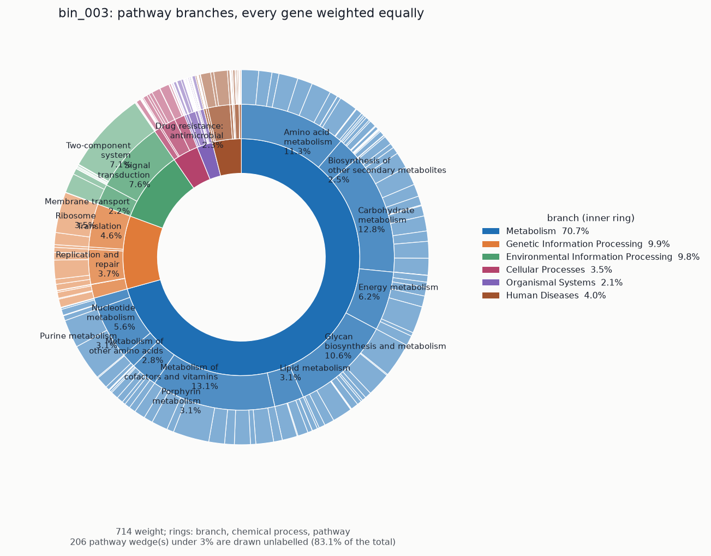
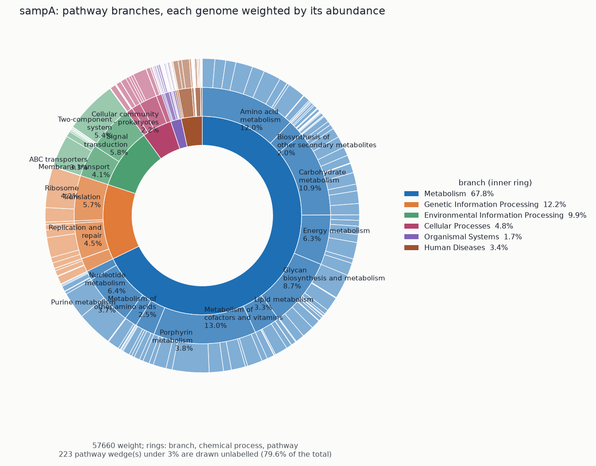
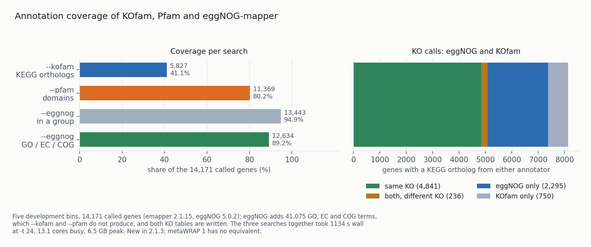
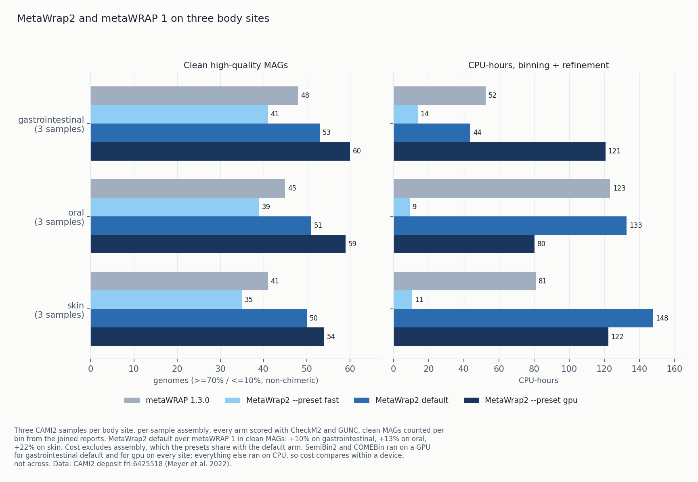
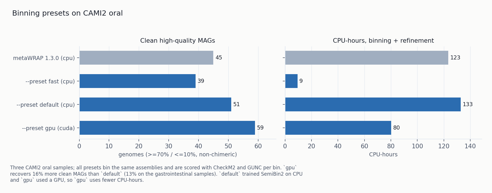
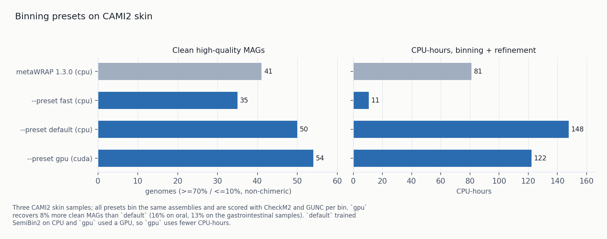

# 2.1.3 - installation fixes, report, MIMAG tags, Bracken and eggNOG

2.1.2 added thirteen modules. 2.1.3 adds few features and is mostly fixes for installation and
first-run problems reported by three testers. Two installed it from scratch on bare machines
following the documentation. The second also ran the full pipeline, which could not finish with the
defaults on a fresh install. The third re-ran metaWRAP 1's 2018 benchmark datasets (36 water samples
and 50 gut samples, on a large server); those fixes are in §2.7.

The release also includes work deferred from 2.1.2: MIMAG quality tags, Bracken in `kraken2`,
eggNOG-mapper in `annotate`, a static image of the functional hierarchy, a tutorial, and benchmarks
on two more CAMI2 body sites (oral and skin) to check the defaults outside gastrointestinal data.

| | 2.1.2 | 2.1.3 |
|---|---|---|
| a conda env in another installation | detected but not runnable; every module `BROKEN` | resolved to a prefix and run; the skip message gives its location |
| databases `install-db` knows | 13 (README lists 18) | 19 with eggNOG, all installable by name |
| CARD | install always failed | installs |
| an interrupted `install-db` | config lost for completed databases | each key written when its database finishes |
| a failed database | `FAILED: dbcan`, no reason | last 15 lines of its output, plus retry advice |
| `--dry-run install-db` | downloaded anyway | prints the plan, downloads nothing |
| `read_qc` on old low-quality reads | discarded 58.5% of a library, no warning | retention always reported, warning below 70%, `--fastp-quality-trim` makes fastp trim |
| `reassemble_bins` | original bin never kept, so 4 of 26 bins were replaced by worse ones; crash on empty plot data | original bin scored as a candidate again |
| `read_qc` on a fresh install | failed at step 1: FastQC 0.13.0 dropped `-o` | uses `--outdir`; pin capped below 0.13 |
| `pathways` on a wheel install | failed: KEGG table missing from the wheel | whole data directory packaged |
| the readiness table | 22 of 24 modules; missing the one with an unmet dependency | all 24, Python extras checked |
| MIMAG tags | none | three columns in every `.stats.tsv` |
| Kraken2 abundance | assigned read counts only | `--bracken` re-estimates at a chosen rank |
| the functional hierarchy as an image | none | one PNG per Krona wheel |
| GPU memory | not recorded | peak VRAM recorded for every step that uses a GPU |
| GO terms and COG categories | none | `annotate --eggnog`: 12,634 of 14,171 genes get a GO term, EC number or COG category |
| benchmark datasets | CAMI2 gastrointestinal | plus CAMI2 oral and skin; MetaWrap2 ahead of metaWRAP 1 on all three, +10%, +13% and +22% clean MAGs |

## 1. Installation fixes

A tester installed MetaWrap2 on a machine with no conda, following only the README, and logged each
problem. Twelve of their findings are fixed here; four of them produced wrong results.

### 1.1 Environments from another conda installation

`quickstart -t 8` reported, in one run:

```
STEP 1/3: creating 23 conda environment(s)
metawrap2-amr already exists; skipping (use --force to recreate).
... (23 lines)
Nothing to create.
```

then, 32 seconds later:

```
  0 OK, 0 missing, 22 broken (of 22 modules)
```

`config.conda_env_exists` checks every conda installation it can see (`conda env list` reads the
machine-global `~/.conda/environments.txt`), while `doctor` ran each tool with `mamba run -n`, which
resolves only against the active root. With a new Miniforge next to an existing one in the same
home directory, `install-env` found the other installation's 23 environments and built nothing, and
`doctor` could run none of them.
`doctor --fix` used the same existence check. `--force` runs `mamba env remove -n <env>` on the other
installation's environments, which is unsafe on a machine with real work in them.

Changes:

- An environment is resolved to a prefix once, and that prefix is used everywhere:
  `mamba run -p <prefix>`, falling back to `-n` when no prefix resolves. `config.env_prefix` already
  did this correctly; `doctor` did not call it.
- `env_dirs` now uses the hardcoded `~/miniforge3/envs`-style guesses only when no env manager
  answers, as its docstring says. Appending them unconditionally caused the collision even when
  `conda env list` was clean.
- `install-env`'s skip message gives the location it found, so a user can see the environment
  belongs to another installation.
- `_probe_tool` reported `not on PATH` for every non-zero exit and discarded libmamba's message
  `The given prefix does not exist: "/.../envs/metawrap2-amr"` (the tester lost fifty minutes on
  this). A missing prefix is now reported as such; other failures quote the tool's output.

### 1.2 Databases added to `install-db`

`install-db --list` had thirteen names; the README's table had eighteen. The five missing ones
(AMRFinderPlus, geNomad, CheckV, Bakta, GTDB-Tk) are needed by `amr`, `viruses`, `annotate --bakta`
and `classify_bins --gtdbtk`.

All five now install by name. As with CheckM2, each uses the tool's own downloader inside its
environment: `amrfinder_update --database`, `genomad download-database`, `checkv download_database`,
`bakta_db download` (`--small` installs the light database, 1.3 GB instead of 30 GB), and GTDB-Tk's
`download-db.sh`. Each writes the resolved path to the key its module reads (`GTDBTK_DATA_PATH` for
GTDB-Tk, not `GTDBTK_DB`) and writes a marker so a re-run skips it.

### 1.3 CARD install

```
refusing to extract '.': it escapes /.../dbs/CARD
FAILED: card
```

`install-db card` failed every time. CARD's tarball has a `.` root member, and the path guard tested

```python
destination = os.path.realpath(os.path.join(target, member.name))
if not destination.startswith(os.path.realpath(target) + os.sep):
```

`realpath` normalises `<target>/.` to `<target>`, which is not a strict prefix of itself, so the
archive's root member was rejected. All 18 real members passed.

This inline check duplicated `_escapes`, which tests for a leading `/` and `..` components and
handles `.` correctly. The duplicate is removed, CARD extracts through the shared `_extract`, and a
test covers a tarball with a `.` member.

### 1.4 Interrupted and failed installs

**Interrupted `install-db`.** The config was written once, after all databases finished. When a
nine-database run was stopped after four had completed (17 GB on disk), `check` reported all four
missing. Each key is now written as soon as its database finishes.

**Failed databases.** `FAILED: dbcan` was the only output; the error went to a stdout shared with
two other databases' progress bars. Re-run by hand it worked (a transient failure under `-t 3`).
Each installer's output is now captured, the last fifteen lines are printed under the FAILED line,
and the run ends with `Re-run the same command to retry; completed databases are detected and
skipped`.

**`--dry-run`.** `metawrap2 --dry-run install-db gtdbtk` would have downloaded ~110 GB, because
`install-db` called subprocess directly instead of going through the runner that the global flag
controls. It now downloads nothing and prints, per database, the downloader command or URL,
destination, both sizes and the config key, then the totals and disk headroom line. Installed
databases show `already present, would skip`.

### 1.5 Database sizes and log output

The size column in `install-db --list` mixed bare sizes, download sizes, download/unpacked pairs and
`~20 GB + indexing`; only four of thirteen rows gave the unpacked size. GUNC, which runs by default
in `bin_refinement`, was listed at 6.7 GB and takes about 13 GB on disk. The table now has four
aligned columns (download, on disk, `--small`, needed by) with totals (~580 GB / ~596 GB / ~160 GB)
and a legend marking estimates. A note says SingleM's metapackage downloads from Zenodo at
150–300 KB/s and takes two to four hours; the other databases download at 0.5–20 MB/s. The README's
table now has the same two size columns.

Three of the four lines of the closing banner were malformed: each line was padded to the box width
before wrapping, so text wrapped into the border. Text is now wrapped to the inner width, then
centred and padded.

The environment build printed nothing for 29 minutes (eleven conda solves), and per-env logs went to
a temp directory. Each environment now prints its start and finish with elapsed time, counted over
the 11 environments instead of 23 modules, and the step banner gives the measured duration.
`quickstart` forwards `--log-dir`.

Other fixes:

- `config init` wrote four placeholder paths uncommented and the other eight commented, so
  `config show` reported four databases as configured but missing instead of not configured. All
  placeholders are now commented.
- `quickstart --skip-envs`, documented as "databases only", printed the environment table and did
  nothing with databases. It now reports database status. In a non-interactive shell with no
  `--databases` it says nothing will be downloaded and gives the option to pass; it does not prompt.
- Skipped steps are numbered instead of omitted.
- `metawrap2 -v`, which the README asks for in bug reports, printed `v=2.1.2` from a checkout one
  commit past that tag. It now prints `MetaWrap2 2.1.3 (git acbd3d1)` from a git checkout and the
  plain version from a wheel.

### 1.6 README example and install requirements

Step 1 of the README example ran `read_qc` on `reads_1.fastq.gz` and step 2 used
`READ_QC/final_pure_reads_*`, but step 3 used the raw `reads_1.fastq reads_2.fastq`, also without
the `.gz`. Copied as written, it failed on a missing file or binned reads that had not been QC'd or
host-filtered. This is fixed, along with two positional paths placed directly after a flag that
takes a value.

The install block now states the Python 3.10+ and conda requirements, with the Miniforge bootstrap;
previously this was 250 lines further down. On stock RHEL 8 or older Ubuntu, `python3` is 3.9 and
`pip install .` fails after downloading scipy, pyrodigal and seaborn. The README also now says, next
to the two commands, that `cohort` is `run --no-coassembly` (previously only in `docs/usage.md`).

## 2. Fixes from a full pipeline run

A second tester installed from scratch, ran the full pipeline on the metaWRAP v1 tutorial cohort
(ERR011347/8/9, 2010-era 75 bp reads) with `--preset slow`, and ran every module. This found three
independent blockers and two defects that changed results without stopping the run.

### 2.1 fastp read retention

Same sample and module, different `--trimmer`:

| trimmer | read pairs kept | mean length |
|---|---:|---:|
| trim-galore | 12,036,979 | 34.3 bp |
| fastp (default) | 5,242,383 | 75.0 bp |

fastp's report: 14,755,926 of 25,242,208 reads discarded, none shortened. The command template set
no quality flags, so fastp used its defaults: drop a read when more than 40% of its bases are below
Q15, and no trimming unless `--cut_front` or `--cut_tail` is set. trim-galore trims the low-quality
tail and keeps the shorter read. On modern data the two give similar results (the CAMI2 benchmark
that made fastp the default found it "kept marginally more reads, bases and Q30 bases"); on 2010-era
reads they differ widely.

Effect on `nonpareil`, same sample QC'd both ways:

| reads | kernel | coverage | fold more sequencing for 95% |
|---|---|---:|---:|
| fastp (default) | k-mer (auto) | 0.646 | 20.0x |
| trim-galore | alignment (auto) | 0.837 | 4.06x |
| this project's documented figure | alignment | 0.844 | 2.5–8x |

With fastp the estimated sequencing effort was five times higher. The documented figure is
reproduced with trim-galore, not with the default.

Retention is now always reported from the trimmer's own report, with a warning below 70%:

```
Read retention: 12,621,104 pairs in -> 5,243,141 out (41.5%): 58.5% removed by quality filtering
fastp kept only 41.5% of the input pairs ... use --trimmer trim-galore, which trims the bad tail
and keeps the shorter read, or keep fastp and add --fastp-quality-trim
```

The default stays fastp: changing a default requires a committed benchmark, and the benchmark set has
no low-quality dataset (gap recorded in `benchmarks/datasets.toml`). Use `--fastp-quality-trim` to
make fastp trim.

### 2.2 `reassemble_bins` original bins

The module chooses the best of three candidates per bin: strict reassembly, permissive reassembly
and the input bin. The input bin was staged as `<bin>.orig.fa`, but CheckM runs with `-x fasta`, so
it was never scored. This call site was missed in the project's `.fa` → `.fasta` rename. On 26 real
bins:

| | strict | permissive | original kept |
|---|---:|---:|---:|
| before | 9 | 17 | 0 |
| after | 7 | 15 | 4 |

4 of 26 bins had been replaced by a worse genome than the input, while the summary reported
`0 bins were not improved by any reassembly`.

The run also crashed with an `IndexError` in the summary plot after 62 minutes. The original bins'
stats table had only a header, and the label index `len(series)//4 - 1` is
`-1` on an empty list. The completion and contamination panels had the same pattern. All three are
guarded, a plotting error no longer fails the module (bins and stats are written before plotting),
and the summary reports how many bins kept their original.

The golden tests covered the arithmetic but not the three-way selection; a fixture where the
original bin is best has been added.

### 2.3 Failures on a fresh install

**FastQC 0.13.** `read_qc` failed at step 1 of 6. The pin was `fastqc >=0.12.1` with no upper
bound, and FastQC 0.13.0 switched to argparse and dropped the short `-o`. The committed lockfile pinned 0.12.1, so
`install-env --from-lock` worked, but the default path used by `quickstart` did not. The call now
uses `--outdir` (accepted by both versions) and the pin is `fastqc >=0.12.1,<0.13`.

**Wheel install.** `pathways` and `quantify_function` failed on a wheel install.
`data/kegg/modules_table.tsv` is in the repository but was not in the wheel: package data listed only the env files, and the KEGG table
was added later. Both modules work under `pip install -e .`, so the bug did not show up in a
checkout. The whole data directory is now included.

**`annotate --bakta` without a database.** With no Bakta database configured, the module ran Bakta
on all 26 bins, each run failed, and it exited 0 with `ANNOTATE PIPELINE SUCCESSFULLY FINISHED`. The
database is now checked first, and a per-item loop in which every item fails now fails the step.

### 2.4 Duplicated helper code

Four bugs had the same cause: code that duplicated a shared helper and got an edge case wrong.

| correct helper | faulty duplicate | effect |
|---|---|---|
| `config.env_prefix()` | `doctor` resolving env names with `mamba run -n` | the install deadlock in §1.1 |
| `install_db._escapes()` | a second, inline tar guard in the CARD installer | CARD install always failed (§1.3) |
| `config.check_databases()` | `config show`'s own `os.path.exists` | a correctly set `BLASTDB_NAME` reported missing |
| `pfam.release_from_notes()` | its own file-path branch | Pfam's release recorded as "unknown" while `relnotes.txt` said 38.2 |

Each now calls the helper. In the Pfam case, given the path `install-db` writes (the HMM file, not
its directory), the function read through a 2.2 GB file looking for a release line.

### 2.5 Output and readiness table

**Readiness table.** `quickstart` ended with `22 OK, 0 missing, 0 broken (of 22 modules)`, then
`diff_abundance` failed for lack of scikit-bio. The table was built from the conda environment list,
so the two modules without an environment (one needs an optional Python extra) were missing.
`doctor` now lists all 24 and checks the extras, `check` has the same section and accepts those two
module names, and `quickstart` no longer says it installs "everything".

**`run --example` tier.** The generated sheet used the `fast` tier: `--metabat2 --maxbin2` under a
comment calling them "the defaults". The README's table gives 41 clean MAGs for that tier against 53
for the default, about 23% fewer. The sheet now takes the tier from `DEFAULT_PRESET`. It also no
longer pins `steps`, which had dropped `coverage` and `dereplicate` from `cohort` mode.

**Log collapsing.** COMEBin logs one line per epoch for 200 epochs, and the log collapser normalises
numbers, so all epochs collapsed to one line. The step printed one line and then nothing for nine
minutes, and no uncollapsed copy was kept. The collapser now re-prints each collapsed message every 30 seconds with current values, and treats an
`n/total` whose count rises at a fixed total as progress. 11,906 metaBAT2 warnings in a 40-minute
step now produce about 80 lines.

**`nonpareil` on `read_qc` output.** `nonpareil -r READ_QC/*/final_pure_reads_1.fastq`, as
documented, always failed because the files share a basename (`read_qc` puts the sample name in the
directory). The sample label now falls back to the parent directory name.

Smaller fixes:

- A stopped `install-db` left curl running, and the next run resumed the same file, so two writers
  at different offsets corrupted it.
- A standalone module run printed no cost line, so the `cores busy` figure, which shows unused
  threads, was missing.
- `status` listed steps alphabetically instead of in execution order.

### 2.6 Testing changes

On the unpatched tree the test suite gave 178 passed, 3 skipped, while four of twenty-four modules
could not run. The unit tests do not cover fresh environment solves, wheel installs, real CheckM
runs, real downloaded tarballs, a second conda installation, or the paths `install-db` writes.

Three CI jobs are added:

1. **Solve the environment yamls fresh** (not `--from-lock`) and run the read-level step on the
   committed fixture, to catch wrapped tools changing their CLI.
2. **Build the wheel and install it into a clean venv**, then run every module's `--help` and a real
   `pathways`. `pip install -e .` in CI cannot catch packaging bugs.
3. **Run the fixture end to end through `metawrap2 run`** and check that the outputs exist (the
   banner also prints on a dry run).

### 2.7 Fixes from large cohort runs

A tester re-ran metaWRAP 1's 2018 benchmark datasets end to end: Baltic Sea water (36 runs, 96 Gbp,
a 418,278-contig co-assembly) and MetaHIT gut (50 runs, 65 Gbp, 187,828 contigs), on a large
CPU-only server.

- **`cohort` binning.** Each sample's binning got `--depth <slice>`, which `binning`
  refuses for SemiBin2, one of the two default binners, so a default `cohort` stopped at the first
  binning step after read QC, assembly and the cohort-wide alignment. `coverage --split-bams` now
  writes one BAM per assembly per sample with that assembly's contig names, and `cohort` passes both
  the depth table (metaBAT2) and the BAMs (SemiBin2).
- **Manifest write race.** `cohort` and `run -j N` could stop with `FileNotFoundError:
  .../manifest.json.tmp` when two steps saved the manifest at once; a 36-sample study at `-j 8`
  stopped this way after 33 assemblies (recovered with `--resume`). The temp file is now per writer, a lock
  covers updating and writing the manifest, and a failed write leaves the previous manifest intact.
- **Kept BAMs with catalogue names.** With `-a LABEL=assembly`, `coverage --keep-bams` left BAMs whose
  contigs were named `LABEL~contig`. SemiBin2, VAMB, COMEBin and CONCOCT matched no contigs against
  the plain assembly and produced no bins, without an error. With one assembly the headers are now
  rewritten; with several, the run warns and gives the `samtools` command to select one assembly.
- **`binning --bams DIR`.** New: bin from existing alignments, so the BAM-reading binners can use
  what `coverage --keep-bams` produced, and alignment and binning can run on different machines.
- **CheckM crash retry.** pplacer inside CheckM sometimes crashed
  (`Dune__exe__Multiprocessing.Child_error`) and `bin_refinement` lost about an hour. It now retries
  with one pplacer thread after clearing the partial output, and then, if that fails too, with
  CheckM's `--reduced_tree`, which can change the marker set and is reported as such.
- **FastTree on protein.** FastTree was always run with `-nt`, but the alignments `phylogeny` is
  documented for (pangenome core genes, GTDB-Tk's MSA) are protein; FastTree then treats most
  residues as ambiguous and still returns a tree. The data type is now measured from the alignment,
  and protein gets `-lg`. IQ-TREE was not affected.
- **Faster depth.** `coverage` ran `samtools depth` on one BAM at a time, which used about 25% of a
  large machine (6h44m for 36 samples). Up to 16 BAMs now run at once; the results are identical.
- **Faster FASTQ check.** The truncation check read inputs in a Python line loop, about 17 minutes
  for a 21 + 23 GB pair. It now counts newlines in 8 MB chunks, through `pigz` where installed, and
  still reads the whole file.
- **Empty bin sets.** `bin_refinement` stopped if any input bin folder was empty, which happens
  whenever a binner finds nothing to cluster. Empty sets are now skipped with a warning and the
  others refined; one remaining set is scored and thresholded as usual; if all are empty the run
  writes an empty final set and warns.
- **Smaller items.** Kept BAMs are indexed. `install-db` for a tool-owned database without its
  environment (for example `checkm2`) now says to run `metawrap2 install-env checkm2` instead of
  failing with a mamba error. MaxBin2's iteration limit is explicit
  (`--maxbin2-max-iteration`, default 50).

## 3. Tutorial

The v1 tutorial had no v2 equivalent. The new tutorial uses simulated data with a known answer, so
results that differ from it indicate a problem with the user's setup.

[docs/tutorial.md](../docs/tutorial.md) has two parts: a ten-minute smoke test on the `tiny` fixture
committed in the repository, with no download; and a full walkthrough on three CAMI2
gastrointestinal samples through read QC, assembly, binning, refinement, quantification and
classification, then `annotate --kofam` + `pathways`. Each step gives a measured cost or states
that it has not been measured. The walkthrough ends with the expected
clean high-quality MAG count.

On the smoke test metaBAT2 forms zero bins, and the tutorial says this is expected. The 257
contigs from three shredded genomes are too few for metaBAT2 to form a cluster, so it writes only its
bookkeeping files, and MetaWrap2 moves `bin.unbinned.fa` out of the bin set. The run exits 0 in about
25 seconds at `-t 4`.

## 4. MIMAG quality tags

Three columns are appended to every `.stats.tsv`: `mimag_tag`, `mimag_rrna` and `mimag_trnas`,
following Bowers et al. (*Nat Biotechnol* 2017). Completeness and contamination were already
measured, and `annotate --bakta` already runs tRNAscan-SE, Aragorn and Infernal, so the rRNA and tRNA
counts are parsed from existing output.

A genome without rRNA/tRNA annotation that meets the high-quality thresholds is tagged
`high_quality_unverified_rrna` with `mimag_rrna=unknown` instead of being downgraded to medium. A bin above 10% contamination is tagged `not_mimag` (no MIMAG tier).

On the 13 refined bins of the project's reference run, annotated without Bakta, 2 are tagged
`high_quality_unverified_rrna` and 11 `medium_quality`. The two meet the MIMAG completeness and
contamination thresholds (99.1%/1.0% and 98.4%/1.6%) and are the two best genomes in the set.

The boundaries follow Bowers' inequalities (>90, <5, ≥50, and 18 of the 20 tRNAs), which differ
from the existing `quality_counts` tiers at 90.00 and 5.00. Tests cover both, and 17 versus 18
tRNAs. tRNAs are counted as distinct amino acids, not as features. `bin_refinement` prints the tier
distribution of its final bin set.

## 5. Bracken

Kraken2 reports the reads assigned to each node. A read matching conserved sequence is assigned at a
higher rank, so a species making up 10% of a community may have only a small share of its reads at
its own node and the rest at genus or family. Bracken (Lu et al., *PeerJ Comput Sci* 2017)
redistributes them using the Kraken2 database's k-mer distribution. On the test fixture, 150 of
1,000 reads at the species node (15%) become 301 estimated reads, 31.7% of the 949
estimated at species level.

Usage: `kraken2 --bracken`, with `--bracken-rank` (species by default) and `--bracken-read-length`.
Bracken needs Kraken2's `--report`, which `kraken2` did not write; `--bracken` now adds it. Without
`--bracken`, Kraken2's output is byte-identical to before.

Bracken exits 0 on every error (a bare `exit` after an `echo`), so the module checks its output
instead of its exit status. Four checks report errors:

- a rank the database was not built for
- a read length absent from the database or shorter than its k
- a `-w` report passed where the abundance table was expected
- a redistribution that moves almost nothing, meaning the Bracken and Kraken2 databases do not match
  and the result is just Kraken2's counts renormalised

The pre-built KRAKEN2 standard database already includes `databaseNmers.kmer_distrib` files for 50
to 300 bp reads, so no extra download is needed. A custom database needs
`bracken-build -d $KRAKEN2_DB -l <read length>`, with `BRACKEN_DB` pointing at the same directory.
Output goes to the pipeline's usual long-format abundance table, which `diff_abundance` reads
directly.

## 6. Functional hierarchy images



`ktImportText` writes only an interactive HTML file, which cannot go into a report, a paper figure or
a message. Rasterising the Krona wheel would need a headless browser.

`metawrap2.sunburst` draws the same wheel with matplotlib (already a hard dependency) from the same
input file Krona uses. `pathways` now writes one PNG next to every Krona HTML file. The interactive
HTML is still written.

`pathways --brite-db` is new. Every other database in the pipeline has both a config key and a
flag. BRITE, which is downloaded instead of bundled, had only `KEGG_BRITE`, so changing snapshots
meant editing `metawrap2.toml`. The flag overrides the config key, and the message printed when
neither is set lists all three ways to supply one.



Drawing choices:

- BRITE's scaffolding branches are kept; dropping them would inflate the remaining percentages.
- Level A is drawn in KEGG's order with a fixed colour per branch, so wheels from different samples
  can be compared.
- Small wedges are drawn but not labelled. The caption gives the number of pathway wedges below the
  label threshold and their share of the total. On one CAMI2 bin, 206 of 251 pathway wedges are
  under 3% and together carry 83% of the weight.

## 7. eggNOG



`annotate --eggnog` runs eggNOG-mapper (Cantalapiedra et al., *Mol Biol Evol* 2021) over the same
proteins as `--kofam` and `--pfam`. eggNOG transfers annotations from the orthologous group a gene
falls in rather than matching a profile, so the GO terms, EC numbers and COG categories on a gene
come from characterised members of its group. Each row keeps `max_annot_lvl`, the taxonomic level
of that group: a term from a genus-level group is more specific than one from a Bacteria-level group.

On five development bins (14,171 genes), all three searches took 1,134 s wall at `-t 24` (6.5 GB
peak, 13.1 cores busy); eggNOG's share was about 100 s per bin, nearly all DIAMOND.

| search | genes placed |
|---|---:|
| `--kofam` | 5,827 (41.1%) |
| `--pfam` | 11,369 (80.2%) |
| `--eggnog`, in an orthologous group | 13,443 (94.9%) |
| `--eggnog`, with a GO term, EC number or COG category | 12,634 (89.2%) |

The extra coverage is small, since Pfam already reaches most genes KEGG reaches (1,578 genes had a
Pfam domain and no KO, 13 the reverse). The new output is 41,075 GO, EC and COG terms. Before this
no module produced GO terms or COG categories, and EC numbers came only from `--cazy`.

eggNOG also calls KOs, and they differ from KOfam's in both directions: 5,077 genes were called by
both (4,841 with the same KO), 2,295 by eggNOG only and 750 by KOfam only. Both tables are written
and the overlap is printed; neither is preferred.

The database is 48 GB (`eggnog.db` 39 GB, `eggnog_proteins.dmnd` 8.7 GB), so `--eggnog` is opt-in
and `install-db eggnog` lists every URL in its plan. eggNOG-mapper 2.1.15 still imports `distutils`,
which was removed in Python 3.12, so it has its own environment (`envs/eggnog.yaml`, Python below
3.12) instead of capping Python in the shared annotate environment.

Two installer defects are fixed:

- The first installer pointed at a host that no longer serves the files and reported `Finished`
  after three 0-byte downloads. It now downloads from `eggnog5.embl.de` through the same checked
  path as the other databases.
- The config value named `eggnog.db` as the key file, the same pattern as the Pfam release bug in
  2.1.2 (§2.4).
 `EGGNOG_DB` is now the directory, and presence is judged by the files in it.

## 8. `report`

`metawrap2 report -o run.pdf RUN_DIR ...` builds one PDF from a finished run's output directories: a
summary page, read QC, assembly statistics, the per-genome table with its quality-tier distribution,
abundance across samples, the functional wheels from §6, and row counts for resistance, viruses and
strains. On the reference run it is 23 pages, with the first result on page 2. The report does no
computation of its own.

A blank cell means the value was not measured; it is never shown as zero. The page before the
appendix lists every module whose output was absent and what was looked for, or states that nothing
is missing.

On the reference run, 13 of the 26 genome rows have no quality values because the abundance table
covers a larger bin set than the refined one; the table notes this.

Two bugs found on the oral benchmark were fixed before release. The report showed
`Genomes (24)` for a study that recovered 62, because it read the first stats table it found instead
of all bin sets. The GUNC lookup also matched *sample_6*'s chimerism report to *sample_13*'s genomes,
since every sample numbers its bins from `bin_001`, giving 23 wrong verdicts and one nonexistent
genome. Each bin set is now paired with the GUNC report in its own directory, rows have a `sample`
column when there is more than one sample, and the heading states the scope:
`Genomes (62 across 3 bin sets)`.

`--mag-table` writes the per-genome table next to the PDF: quality, MIMAG tag, GUNC verdict,
taxonomy, size, N50, GC and per-sample abundance, joined on bin name across the three forms used in
the pipeline's files (`bin_001`, `bin_001.fasta`, `bin.1`). The report uses matplotlib's `PdfPages`, so
it needs no HTML toolchain, browser or network access.

## 9. Packaging

Dependencies now have upper bounds at the highest tested version. With only `pandas>=1.3` and
`numpy>=1.20`, a fresh install resolved to pandas 3.0.6 and numpy 2.5.4, two major versions with
breaking changes that had never been tested here. The tested versions are listed in a comment.

**GPU selection.** `--device cuda:N` now puts all three learned binners on card N. Before, only
COMEBin used the index: SemiBin2 and VAMB ran on device 0, which on a multi-GPU host could be a card
already in use. Each binner now runs with `CUDA_VISIBLE_DEVICES` set to the requested card. Bare
`--device cuda` and `auto` are unchanged.

**GPU memory.** `rusage` does not see GPU memory, so a step that uses a GPU now has its peak VRAM
sampled every 5 seconds (`nvidia-smi --query-compute-apps`), counting only the step's own processes
and taking the largest single device. It is written to the manifest as `peak_gpu_memory_bytes` and
shown in the cost line. On NVIDIA GPUs: COMEBin 5.71 GB on both a 16,936-contig and a
63,376-contig assembly, SemiBin2 0.41 GB rising to 2.75 GB over the same pair, VAMB 0.56 GB. The
README has a new [Hardware](https://github.com/ursky/MetaWrap2#hardware) section with these figures
and per-step RAM.

## 10. Limitations

**Install testing.** The install findings come from one session on one Linux distribution with a
fresh Miniforge. The cross-installation bug needs only a `metawrap2-*` environment visible to conda,
so it also affects reinstalls, HPC login nodes with a site conda plus a personal Miniforge, and
shared machines.

**Bracken accuracy.** Bracken is tested against the real Bracken binary on synthetic inputs, not on a
community with known composition. The 15% to 31.7% example comes from a hand-written Kraken2 report.
Accuracy on real samples needs a CAMI2 benchmark, not in this release.

**MIMAG tags without rRNA data.** Without `annotate --bakta`, rRNA status is `unknown`, so most runs
will show `high_quality_unverified_rrna` instead of `high_quality`.

**Release tags.** The repository has no git tags, so `git checkout v2.1.2` fails and a clone
cannot be checked out at, or identified as, a specific release. `metawrap2 -v` now prints the commit
for bug reports. Tags need to be pushed by someone with write access; until then, the current
release is the state of main described here.

**Trimmer default.** All benchmark datasets are simulated CAMI2 reads, which are uniformly high
quality. fastp and trim-galore differ only on low-quality data, where fastp discarded 58.5% of a real
library, so the current default has not been benchmarked in that case. The retention report warns
about it; deciding the default needs a low-quality dataset registered in `benchmarks/datasets.toml`.

**Real short-read data.** On the real short-read tutorial data, the assembler comparison went the
other way from CAMI2: metaSPAdes gave 48% more assembled bases and a 112% longer N50 at 24 GB peak
memory, compared with 14% fewer bases and 38% longer N50 at ~140 GB on CAMI2. `--preset slow` gave
58% more clean MAGs than `default` on that dataset, against +13% on CAMI2 gastrointestinal and
+16% on CAMI2 oral (§11.1). Neither result changes a default on its own, but the defaults should be
re-measured on real short-read data, and memory figures should be quoted with their dataset.


**Body sites.** The defaults are tested on three human body sites (gastrointestinal, oral and skin,
§11), not on soil, marine or non-host samples. Two more human sites (airways, urogenital) are in the
same deposit; they would add body sites but not a new kind of community.

## 11. CAMI2 oral and skin benchmarks

All defaults were measured on three CAMI2 gastrointestinal samples. The metaWRAP 1 comparison was
repeated on oral and on skin. Skin is a low-diversity community dominated by a few genera, so it
also differs from the gut samples in community structure.



| Body site, 3 samples | metaWRAP 1.3.0 | MetaWrap2 default | Difference | CPU-hours, mw1 vs mw2 |
|---|---|---|---|---|
| gastrointestinal | 48 clean HQ (52 HQ) | 53 clean HQ (56 HQ) | +10% | 132.0 vs 127.1 |
| oral | 45 clean HQ (49 HQ) | 51 clean HQ (57 HQ) | +13% | 172.6 vs 184.9 |
| skin | 41 clean HQ (48 HQ) | 50 clean HQ (57 HQ) | +22% | 136.2 vs 200.2 |

The figure also shows `--preset fast` and `--preset slow` on every site. Its
cost panel is binning plus refinement, since the presets share the default arm's assemblies; the
table gives end-to-end CPU-hours.

MetaWrap2 is ahead on all three sites, most on skin. All arms are scored with CheckM2 and GUNC
instead of each pipeline's own scorer, and clean high-quality MAGs are counted per bin from the join
of the two, not estimated as HQ × pass fraction. The gastrointestinal arms were re-scored the same
way, so all six numbers use one method.

CPU cost cannot be compared across sites. The gastrointestinal arm trained SemiBin2 on a GPU
(0.6 GPU-hours) and the oral and skin arms used the default CPU training, which accounts for the
difference (124 and 139 cpu-hours of binning against 32). Within a site, MetaWrap2 is 4% cheaper
than metaWRAP 1 on gastrointestinal, 7% more expensive on oral and 47% more expensive on skin, where
it recovers 9 more clean MAGs for 64 more cpu-hours.

Per sample (MetaWrap2 / metaWRAP 1 clean HQ): oral sample_6 20/17, sample_7 13/10, sample_13 18/18;
skin sample_17 14/10, sample_18 17/16, sample_19 19/15. MetaWrap2 is ahead on five of the six samples
and equal on one.

**Dataset.** The deposit the gastrointestinal data comes from (`frl:6425518`, CC BY 4.0, Meyer et al.
2022) has 49 short-read samples from five body sites with the same per-contig gold standard and
layout, plus PacBio-simulated versions of all 49, which can be used for a later long-read benchmark.
`cami2_oral` and `cami2_skin` each use three samples, matching the three-sample design of the
gastrointestinal comparison, with md5s pinned from the publisher's manifest and every byte count
measured by HEAD request, as `benchmarks/datasets.toml` requires.

Body sites were checked after extraction instead of assumed from sample numbering. Oral: of each
sample's genomes, 88 of 89, 176 of 177 and 159 of 159 are in the oral gold standard, against 4–5 in
the gastrointestinal one (the two gold standards share 9 genomes out of 797 and 259). Skin: the
deposit's 29 `airskinurogenital` samples are not labelled by site. 88 of 90, 50 of 52 and 238 of 240
of the genomes in samples 17, 18 and 19 are in the skin gold standard, about half as many in the
airways one and almost none in the urogenital one. The three sites are interleaved in the deposit
rather than in blocks; `benchmarks/datasets.toml` lists which samples belong to each.

### 11.1 Binning presets on oral

The preset comparison in [Benchmarks](../docs/benchmarks.md) is from the gastrointestinal samples only,
and the user-testing run in §10 found `--preset slow` well ahead of `default` on real short reads. All
presets were run on the oral samples, scored with the same per-bin CheckM2 ∩ GUNC join:



| arm | binners | device | clean HQ | HQ | bins | cpu-h, binning + refinement |
|---|---|---|---:|---:|---:|---:|
| `--preset fast` | metaBAT2 + MaxBin2 | cpu | 39 | 50 | 53 | 9.4 |
| metaWRAP 1.3.0 | metaBAT2 + MaxBin2 + CONCOCT | cpu | 45 | 49 | 58 | 123.4 |
| `--preset default` | metaBAT2 + SemiBin2 | cpu | 51 | 57 | 62 | 132.8 |
| `--preset slow` | + COMEBin | cuda | 59 | 63 | 77 | 80.3 |

`slow` recovers 16% more clean MAGs than `default` on oral, against 13% on the gastrointestinal
samples (60 vs 53), and is ahead on each sample (23/20, 15/13, 21/18). No default changed.
Making `slow` the default needs its cost measured with SemiBin2 and COMEBin on CPU, which is what
most users have.

The cost column is binning plus refinement only, since the preset arms reuse the `default` arm's
assemblies. `default` trained SemiBin2 on CPU and `slow` used a GPU, so `slow` shows fewer
CPU-hours. The comparable pair is `fast` and `default`, both on CPU: 9.4 against 132.8 CPU-hours for
39 against 51 clean MAGs. `fast` recovers fewer clean MAGs than metaWRAP 1 (39 against 45) for 7% of
its compute.

### 11.2 Binning presets on skin



| arm | binners | device | clean | HQ | CPU-h, binning + refinement |
|---|---|---|---:|---:|---:|
| `--preset fast` | metaBAT2 + MaxBin2 | cpu | 35 | 41 | 10.7 |
| metaWRAP 1.3.0 | metaBAT2 + MaxBin2 + CONCOCT | cpu | 41 | 48 | 81.0 |
| `--preset default` | metaBAT2 + SemiBin2 | cpu | 50 | 57 | 147.7 |
| `--preset slow` | + COMEBin | cuda | 54 | 59 | 122.3 |


`slow` recovers 8% more clean MAGs than `default` on skin, against 16% on oral and 13% on
gastrointestinal, so the third binner adds less on the low-diversity community. Per sample it wins
two and ties one (15/14, 17/17, 22/19); on the tie it made one more high-quality bin, which GUNC
failed. `fast` again recovers fewer clean MAGs than metaWRAP 1 (35 against 41), for 13% of its
compute. The same caveats as §11.1 apply. On sample_17, CheckM1 inside `bin_refinement` needed
`--reduced_tree` for COMEBin's bin set, so that sample's choice between hybrid sets used a slightly
different scorer; all counts above come from the shared CheckM2 ∩ GUNC join.
