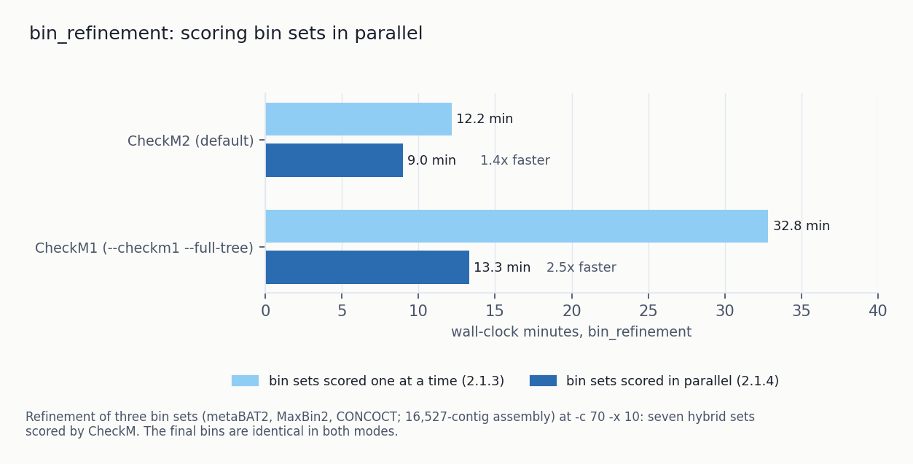
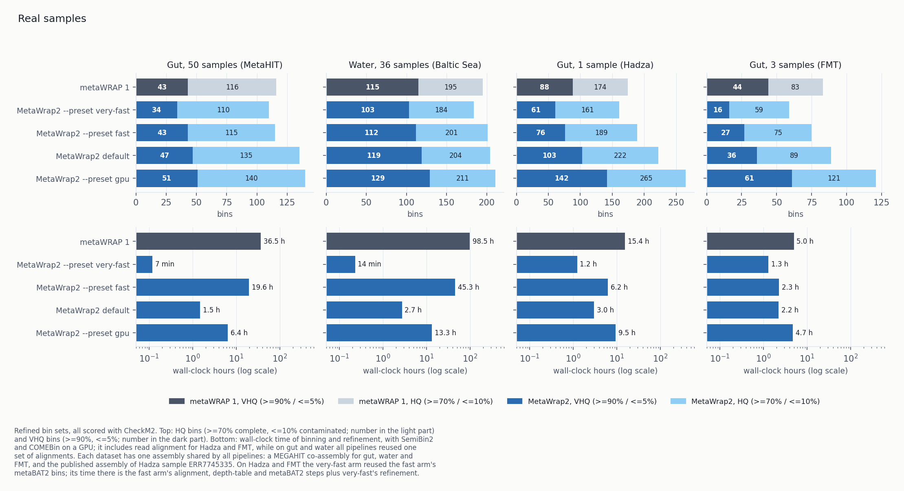

# 2.1.4 - CheckM2 by default, `metawrap2 score`, faster refinement, progress reporting

New: a command that scores any bin set, progress and utilisation messages for long steps, checked
downloads, a GPU check, and benchmark arms that run other pipelines. `--preset slow` is renamed
`--preset gpu`, and bins are scored with CheckM2 by default. Also six fixes, a benchmark on real
samples, and documentation changes.

| | 2.1.3 | 2.1.4 |
|---|---|---|
| three-binner preset | `--preset slow`, trains on CPU unless `--device` is set | `--preset gpu` (`slow` still accepted), trains on cuda by default |
| aligner index | rebuilt on every call; parallel mappings wrote the same file | reused when complete and current; parallel mappings take turns |
| empty bin folder in `dereplicate` | stopped the run | skipped with a warning |
| empty first bin set in the refinement plot | NameError, refinement stopped | plotted |
| real-sample benchmark | none | four datasets: gut and water from the metaWRAP 1 paper, one sample, three samples |
| scoring another pipeline's bins | not possible | `metawrap2 score` |
| long step with no output | nothing printed | heartbeat after 60 s without output |
| a step using few of its cores | `-j` suggestion after the run | warning during the step (Linux) |
| downloads | curl, size checked | aria2c or curl, md5 or test decompression |
| GPU device | first error at the binner's first allocation | checked before the step |
| CheckM in `bin_refinement` | one bin set at a time | several at once when memory allows; 1.4× faster with CheckM2, 2.5× with `--checkm1 --full-tree` |
| bin scorer (`bin_refinement`, `reassemble_bins`, `binning --run-checkm`, `benchmark score`) | CheckM1; `--checkm2` for CheckM2 | CheckM2; `--checkm1` for CheckM1, except in `reassemble_bins` |
| CheckM1 genome tree (`--checkm1`) | full; `--quick` for the reduced tree | reduced; `--full-tree` for the full tree |

## New features

- **`metawrap2 score`.** `metawrap2 score -o OUT bins_a bins_b ...` scores directories of genomes
  with CheckM2 (or CheckM1 with `--checkm1`) and GUNC, writes the same per-genome table as
  `bin_refinement`, and prints one comparison table. Use it to compare bin sets from different
  pipelines with the same scorer. `-x` sets the FASTA extension. See [score](../docs/score.md).
- **Progress heartbeat.** After 60 s without output, a step prints its elapsed time and the tool's
  last line, so a long step with no output (for example COMEBin training) can be told from a hung
  one. Screen only. Set `heartbeat_seconds` under `[settings]` or pass `--heartbeat-seconds N`; 0
  turns it off.
- **Low-utilisation warning.** On Linux, a step that has run for five minutes with less than a third
  of its thread grant busy prints a warning once. More threads would not speed such a step up; the
  warning suggests `-j` to run other samples on the idle cores.
- **Verified downloads.** Benchmark data and `install-db` databases are downloaded to `.part`,
  checked by md5 or by test decompression, and renamed only if they pass. A size check alone is no
  longer accepted. With aria2c installed, files are fetched over several connections (several times
  faster from ENA); otherwise curl is used, with the same checks.
- **GPU check.** Before SemiBin2, VAMB or COMEBin run on a GPU, MetaWrap2 reports the card, its
  free memory and other processes using it. A device index that does not exist stops the run before
  the step. A busy card prints a warning; `--gpu-strict` stops instead.
- **External benchmark arms.** A variant in `benchmarks/configurations.toml` can run another
  pipeline (for example metaWRAP 1.3.0 in its own conda env) on the same inputs and budget. It is
  measured and scored in the same way as the MetaWrap2 arms.
- **Faster refinement.** `bin_refinement` scores the hybrid bin sets with CheckM2 several at a time
  when memory allows (`--checkm-jobs N`; default: as many as fit at about 24 GB per CheckM2 call, or
  with `--checkm1` 16 GB per CheckM1 call on the reduced tree and 40 GB with `--full-tree`). Each bin
  is assigned to one set before scoring starts, so results match a one-at-a-time run. pplacer is
  capped at 8 threads. On a three-binner refinement, CheckM2 took 9.0 minutes instead of 12.2 and
  CheckM1 on the full tree 13.3 instead of 32.8, with identical final bins.
  
- **CheckM options.** `--checkm2-ttable 11` makes CheckM2 call genes under one translation table,
  which halves its gene calling.

## `--preset gpu`

`--preset slow` is renamed `--preset gpu`. It runs the same binners (metaBAT2, SemiBin2 and
COMEBin) and now trains SemiBin2 and COMEBin with `--device cuda` unless `--device` is given. On a
CPU, COMEBin did not finish three CAMI2 samples in 280 CPU-hours. The other presets keep
`--device cpu`, so their results do not depend on the hardware. `--preset slow` still works and
prints that it is the old name; study sheets accept it.

## Fixes

- **Aligner index reuse.** `binning` and `coverage` rebuilt the aligner index on every call, so
  `--resume` re-indexed an assembly that was already indexed, and parallel mappings against one
  reference all wrote the same index file. An index is now reused when all its files exist, are
  non-empty and are newer than the reference, and a marker written after a successful build records
  the same index command. A lock makes parallel mappings take turns. The marker also stops a
  short-read minimap2 index from being reused for long reads.
- **Empty bin folders in `dereplicate`.** A sample with no bins (common in cohorts) left an empty
  folder, which stopped the run. Empty folders are now skipped with a warning.
- **Refinement plot with an empty first bin set.** `plot_binning_results` raised NameError, which
  stopped `bin_refinement` after CheckM and GUNC had run. The plot is now drawn.
- **Test failure with long temporary paths.** `test_bin_refinement_empty_sets` matched a
  phrase that the warning banner could wrap. It now strips the banner first.
- **Full `quickstart`.** Without `--binning-only` or `--modules`, quickstart passed no environments
  to `install-env` and stopped at step 1. It now builds every module environment plus
  `metawrap2-checkm2` and `metawrap2-learned`.
- **CAMI2 skin composition.** `benchmarks/datasets.toml` said the deposit's three non-oral body sites
  are stored in blocks; they are interleaved. The file now lists which sample belongs to which site.
  The `cami2_skin` samples used in 2.1.3 were correct.

## Real-sample benchmark

Four real datasets, each binned by every pipeline from one shared assembly: the metaWRAP 1 paper's
50 MetaHIT gut samples and 36 Baltic Sea water samples (one MEGAHIT co-assembly each), one deeply
sequenced Hadza gut sample (ERR7745335, published assembly), and a three-sample faecal-transplant
series (one MEGAHIT co-assembly). All final bin sets are scored with CheckM2 and GUNC.

| Clean MAGs (wall-clock time) | Gut, 50 samples | Water, 36 samples | Gut, 1 sample | Gut, 3 samples |
|---|---:|---:|---:|---:|
| metaWRAP 1 | 94 (36.5 h) | 183 (98.5 h) | 158 (15.4 h) | 72 (5.0 h) |
| MetaWrap2 `very-fast` | 91 (7 min) | 162 (14 min) | 154 (1.2 h)* | 52 (1.3 h)* |
| MetaWrap2 `fast` | 85 (19.6 h) | 182 (45.3 h) | 169 (6.2 h) | 56 (2.3 h) |
| MetaWrap2 default | 110 (1.5 h) | 184 (2.7 h) | 207 (3.0 h) | 78 (2.2 h) |
| MetaWrap2 `gpu` | 125 (6.4 h) | 197 (13.3 h) | 250 (9.5 h) | 111 (4.7 h) |

\* `very-fast` reused the `fast` arm's metaBAT2 bins on these two datasets; its time is that arm's
alignment, depth-table and metaBAT2 steps plus its own refinement.

The default recovers more clean MAGs than metaWRAP 1 on all four datasets (17% more on gut, about
the same on water, 31% more on the single sample, 8% more on three samples) in 1.5 to 3.0 hours.
`gpu` recovers 8% to 58% more. On three samples the default has fewer ≥90% / ≤5% bins than
metaWRAP 1 (36 against 44). By CheckM2, 174 of the 186 bins metaWRAP 1 kept on the single sample
meet its own thresholds.

## CAMI2 and CAMI3 gold assemblies (AMBER)

Each pipeline also binned the gold assemblies of CAMI2 gastrointestinal, oral and skin and a CAMI3
toy dataset. AMBER compares every bin with the known contig-to-genome assignment. Bins at ≥90%
complete and ≤5% contaminated by that measure:

| | metaWRAP 1 | `very-fast` | `fast` | default | `gpu` |
|---|---:|---:|---:|---:|---:|
| CAMI2 gastrointestinal | 115 | 84 | 109 | 135 | 179 |
| CAMI2 oral | 146 | 96 | 134 | 156 | 247 |
| CAMI2 skin | 101 | 82 | 100 | 135 | 197 |
| CAMI3 toy | 175 | 124 | 166 | 161 | 215 |

bp-weighted F1:

| | metaWRAP 1 | `very-fast` | `fast` | default | `gpu` |
|---|---:|---:|---:|---:|---:|
| CAMI2 gastrointestinal | 0.67 | 0.54 | 0.67 | 0.75 | 0.85 |
| CAMI2 oral | 0.36 | 0.25 | 0.35 | 0.39 | 0.53 |
| CAMI2 skin | 0.38 | 0.30 | 0.36 | 0.47 | 0.59 |
| CAMI3 toy | 0.21 | 0.16 | 0.21 | 0.23 | 0.23 |

The default recovers more of these bins than metaWRAP 1 on CAMI2 and fewer on CAMI3; `gpu`
recovers more on all four. CAMI3 counts use its prokaryote-only truth. The README's
synthetic-benchmark figure shows the bin counts with wall-clock times.

## Documentation

- The README benchmark section is split into synthetic communities (CAMI2) and real samples.
- Release notes moved to [`releases/`](.) at the top of the repository.
- Open items from the 2.1.3, functional-annotation and other-modules plans are in
  [PLANNED_FEATURES.md](../PLANNED_FEATURES.md).
- `docs/modules.md` is now one reference entry per module.

## Changed defaults

- Bins are scored with CheckM2 in `bin_refinement`, `reassemble_bins` and `binning --run-checkm`,
  as in `metawrap2 score`. CheckM2 needs less memory than CheckM1 on its full genome tree (pplacer
  holds about 34 GB per call), is faster, and scored the final bins in the MetaWrap2 benchmarks.
  `--checkm1` scores with CheckM1 in `bin_refinement` and `binning --run-checkm`; install its data
  with `metawrap2 install-db checkm`, or the run stops at the start and names that command.
  `--checkm2` is still accepted and changes nothing.
- With `--checkm1`, `bin_refinement` and `binning --run-checkm` use CheckM1's reduced tree
  (`--reduced_tree`, about 16 GB per call). `--full-tree` uses the full genome tree (about 40 GB),
  as 2.1.3 did. `--quick` is no longer listed; it is still accepted and prints that the reduced tree
  is the default.
- `reassemble_bins` scores with CheckM2 only. `--checkm1` stops with an error, `--checkm2` is
  accepted, and CheckM1's `reassembled_bins.png` QA plot is no longer made. `reassembly_results.png`
  is unchanged.
- `benchmark score` scores with CheckM2. `--checkm1` (deprecated) scores with CheckM1 on the full
  tree, and `--checkm2` is accepted. Score caches and `.stats.tsv` tables are kept per scorer, so
  CheckM1 scores from an earlier `benchmark score` are scored again, not read as CheckM2 scores.
- `quickstart` builds `metawrap2-checkm2`, and `quickstart --binning-only --databases` fetches the
  CheckM2 and GUNC databases instead of CheckM1's: about 16 GB on disk (3 GB + 13 GB) in place of
  1.4 GB.
- `doctor bin_refinement` and `doctor reassemble_bins` count a missing `metawrap2-checkm2` as a
  failure, and `doctor --fix` rebuilds it.
- A `bin_refinement --resume` must use the scorer and CheckM1 tree the run started with; a run begun
  under 2.1.3's default needs `--checkm1 --full-tree`.
- `--preset gpu` (formerly `slow`) trains on cuda unless `--device` is given.
- The heartbeat is on (`heartbeat_seconds = 60`); set it to 0 for the old behaviour.
- The `-j` suggestion after a run uses a third of the thread grant as its threshold (was a quarter),
  the same as the new warning.
